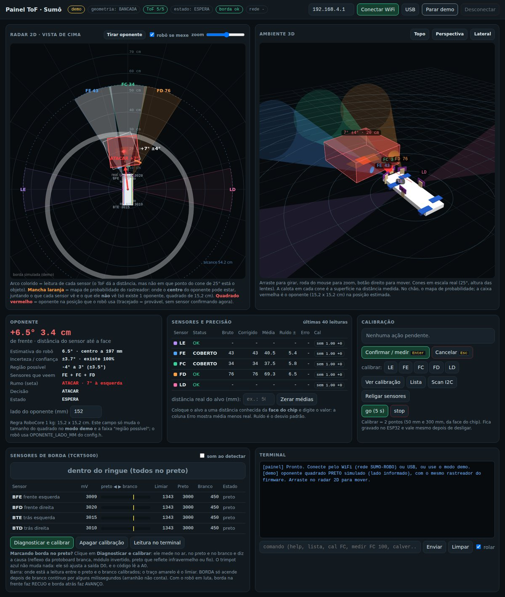
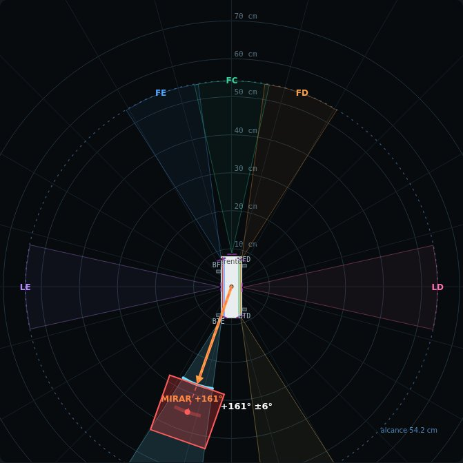
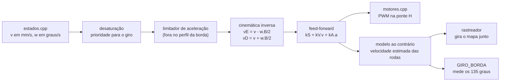
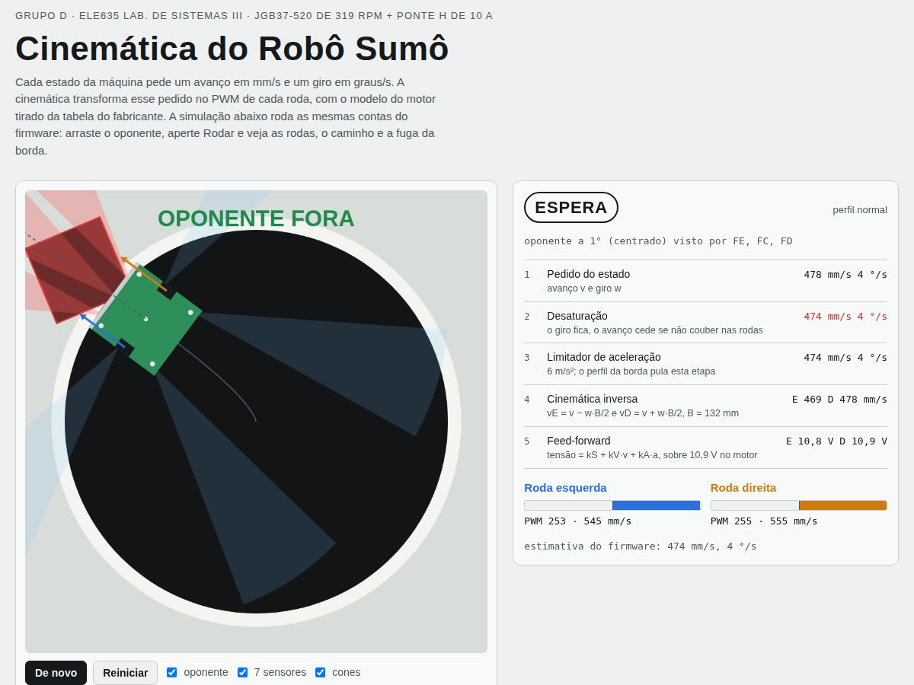
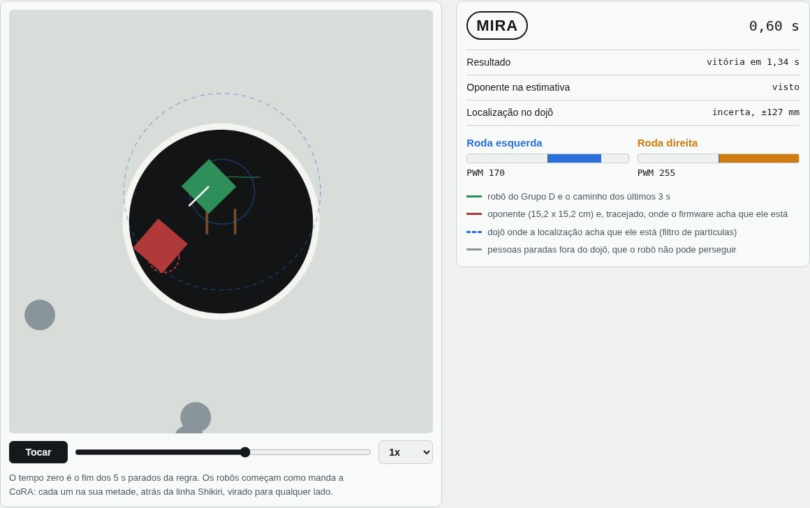
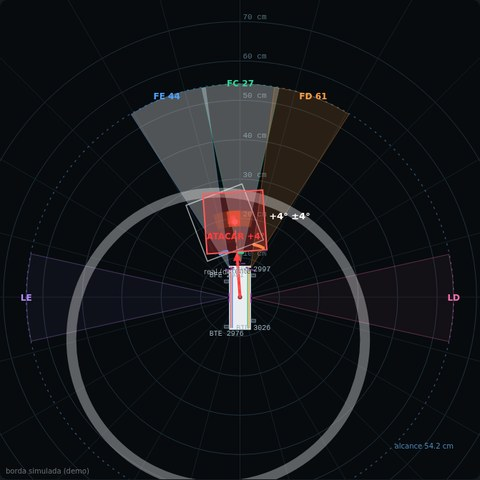
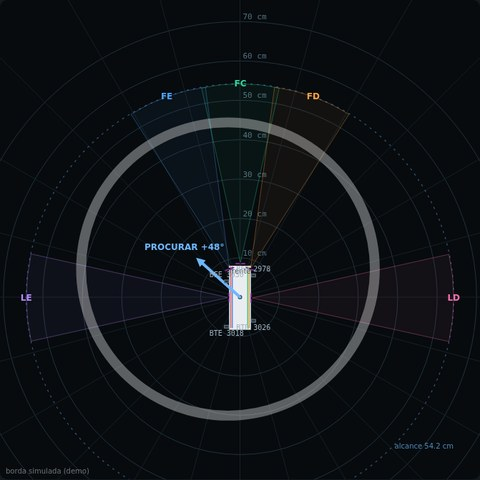
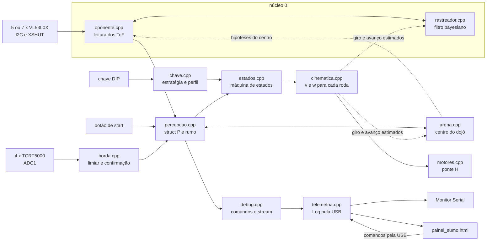
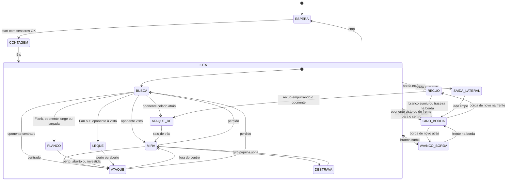

# Robô Sumô 1 kg com ESP32


[](https://github.com/felcoslop/LAB_III_Grupo_D_UFMG_2026_2/actions/workflows/compilacao.yml)
[](https://felcoslop.github.io/LAB_III_Grupo_D_UFMG_2026_2/)

Firmware e painel de telemetria do robô sumô autônomo da classe de 1 kg do **Grupo D**, desenvolvido na disciplina ELE635 Laboratório de Sistemas III da UFMG. O ESP32 lê cinco ou sete sensores de distância VL53L0X e quatro sensores de linha TCRT5000, estima onde está o oponente com um filtro bayesiano em grade, estima onde fica o centro do dojô com um filtro de partículas e decide o movimento com uma máquina de estados de três estratégias, escolhidas na chave DIP. Um painel web, que abre direto no navegador e conversa com o robô pela USB, mostra sensores, mapa de probabilidade, rumo e estado em 2D e 3D, e um simulador com o firmware de verdade roda lutas inteiras no GitHub Pages.



## Sumário

- [Contexto](#contexto)
- [Funcionalidades](#funcionalidades)
- [Hardware](#hardware)
- [Cinemática das rodas](#cinemática-das-rodas)
- [Estratégias e chave DIP](#estratégias-e-chave-dip)
- [Localização no dojô](#localização-no-dojô)
- [Lutas simuladas](#lutas-simuladas)
- [Combate com dois firmwares](#combate-com-dois-firmwares)
- [Montagem 3D](#montagem-3d)
- [Instalação](#instalação)
- [Uso](#uso)
- [Arquitetura](#arquitetura)
- [Mapa do código](#mapa-do-código)
- [Configuração](#configuração)
- [Estrutura de pastas](#estrutura-de-pastas)
- [Integração contínua](#integração-contínua)
- [Equipe](#equipe)
- [Referências](#referências)

## Contexto

O projeto faz parte da disciplina ELE635 Laboratório de Sistemas III, do curso de Engenharia de Sistemas da UFMG, no semestre 2026/2, com o Prof. Gustavo Medeiros Freitas. A disciplina cobre o ciclo completo de um projeto de engenharia, da concepção até a competição, e o robô segue a classe de 1000 g (Lego/Vex Sumô) das regras de sumô da RoboCore [ROBOCORE, s.d.a]: massa de até 1000 g, base de 15,2 x 15,2 cm, dojô (no código, dohyo) preto de 77 cm de diâmetro com borda branca de 2,5 cm, controle totalmente autônomo e início obrigatório 5 s depois do comando.

A versão atual roda em uma bancada de teste. Os sensores ficam presos em uma protoboard que faz o papel de chassi provisório, e o ESP32 fica ligado ao computador pela USB, que alimenta a placa e leva a telemetria. Nessa fase os motores ficam desligados no firmware (`USAR_MOTORES 0`), mas a máquina de estados roda normalmente e o painel mostra o comando que iria para cada roda.

## Funcionalidades

- Identificação dos VL53L0X (5 ou 7, escolhidos no `config.h`) pelo pino XSHUT, com endereço I2C próprio para cada sensor e nova tentativa automática quando algum para de responder.
- Leitura escalonada e sem bloqueio dos ToF, com mediana de 3 leituras e calibração de 2 pontos gravada na memória do ESP32.
- Rastreador bayesiano em grade polar, que aproveita também a informação dos sensores que não veem nada e reconhece a arena vazia. A leitura dos ToF e o rastreador rodam no núcleo 0, e o loop com a borda, a localização e a estratégia roda no núcleo 1.
- Perfil de oponente escuro na DIP 4: sensores com mais tempo de medida e limiar de sinal menor para robôs pretos e foscos, e o rastreador com o modelo de ruído desse perfil. O perfil claro continua igual ao de antes.
- Localização no dojô sem encoder: um filtro de partículas estima onde fica o centro do dojô a partir do modelo das rodas e dos sensores de borda. A fuga da borda termina virada para o centro, a busca volta para o meio e leituras de pessoas e objetos fora do dojô não viram oponente.
- Três estratégias na chave DIP (Rush, Flank e Fan out), com resposta de frente a investidas rápidas, empurrão de ré com o oponente colado atrás e reconhecimento do oponente encostado na lateral.
- Rumo (a seta do painel) até o oponente ou até os pontos cegos, usado pela máquina de estados na busca.
- Leitura analógica da linha branca, com confirmação por tempo e calibração guiada em três medidas (ar, preto e branco).
- Máquina de estados com contagem obrigatória de 5 s, busca, mira, ataque, flanco, ataque de ré e fuga da borda em quatro direções, sem nunca girar para trás quando a borda está atrás.
- Reconhecimento de travamento sem encoder: o giro preso pelo oponente encostado na lateral vira uma manobra curta de soltura, e o empurrão longo em contato aparece no painel, reconhecido também pela caixa do rastreador parada, com cinco manobras experimentais de saída que se desligam no `config.h`; um modelo térmico de cada motor limita o PWM das manobras se o motor travado esquentar demais.
- Cinemática das duas rodas com o modelo do motor JGB37-520 e da ponte H: cada estado pede avanço em mm/s e giro em graus/s, a fuga da borda usa a tensão toda na hora e o firmware não compila se a distância de parada não couber na margem até as rodas. Os comandos `pwm` e `mov` testam os motores com o robô parado.
- Painel 2D e 3D em um único arquivo HTML, sem internet, ligado ao robô pela USB, com dados a 50 Hz e comandos pelo navegador.
- Firmware sem rádio: o robô compete de forma autônoma, sem WiFi e sem Bluetooth, o que deixa o núcleo 0 livre para os sensores e o rastreador.
- Simulador de lutas (software in the loop): o firmware compilado no computador luta contra seis tipos de oponente, com pessoas paradas em volta do dojô, e o CI roda uma bateria de lutas em todo pull request.
- Terminal de comandos pela USB ou pelo painel para teste, calibração e diagnóstico.

## Hardware

| Componente | Qtd. | Uso no projeto |
|---|---|---|
| ESP32 DevKit V1 (30 pinos) com placa de expansão | 1 | microcontrolador de dois núcleos, com ADC (o rádio fica desligado) |
| VL53L0X (placas CJVL53L0XV2 / GY-530) | 5 ou 7 | distância até o oponente: LE, FE, FC, FD e LD, mais TE e TD na versão de 7 |
| TCRT5000 com comparador LM393 | 4 | linha branca da borda, lida pela saída analógica A0 |
| Motor JGB37-520, 12 V, 319 rpm (redução de 18,8:1) | 2 | tração, com pneu StickyMAX S20 de 32 mm [ROBOCORE, s.d.b] |
| Bateria 3S de Li-ion (18650) com BMS | 1 | alimentação dos motores; o ESP32 tem bateria e conversor próprios |
| Módulo HW-956 de ponte H dupla de 10 A (3 a 18 V, entradas IN1 a IN4) | 1 | ponte H de MOSFET dos dois motores, com PWM de até 2 kHz (desativada na bancada) |
| Botão | 1 | start, ligado entre o GPIO 0 e o GND, em paralelo com o botão BOOT da placa |
| Chave DIP de 4 vias | 1 | ligada nos GPIOs 12, 14, 2 e 15: estratégia (DIP 1 a 3) e perfil do oponente escuro (DIP 4) |

| Função | GPIO | Observação |
|---|---|---|
| I2C SDA / SCL | 21 / 22 | barramento comum dos ToF, a 100 kHz |
| XSHUT LE / FE / FC / FD / LD | 17 / 23 / 19 / 18 / 5 | um fio por sensor, define o nome de cada um; o 5 é pino de boot e precisa de nível alto, o mesmo do XSHUT ligado |
| XSHUT TE / TD (só com 7 sensores) | 16 / 4 | sem restrição de boot |
| Borda BFE / BFD (frente) | 34 / 35 | ADC1, pinos só de entrada |
| Borda BTE / BTD (trás) | 32 / 33 | ADC1 |
| Ponte H IN1 / IN2 | 25 / 26 | motor esquerdo, com o PWM de 1 kHz no próprio IN |
| Ponte H IN3 / IN4 | 27 / 13 | motor direito |
| Botão de start | 0 | `INPUT_PULLUP`, nível baixo indica botão apertado; não pode estar apertado na hora de ligar |
| Chave DIP 1 a 4 | 12 / 14 / 2 / 15 | cada via liga o pino no 3V3 |

A pinagem segue o documento de ligação da placa nova (Lab3-Liga) e o esquema do Fritzing. Todos os sensores ficam no 3V3 do ESP32. As placas clone do VL53L0X puxam SDA e SCL para 2,8 V, nível que o ESP32 entende como 1, e o firmware nunca coloca nível alto no XSHUT: para desligar um sensor o pino vira saída em LOW e, para ligar, vira entrada com o pull-up interno. Os sensores de borda usam os pinos 34, 35, 32 e 33 do ADC1 e precisam do fio na saída A0 dos módulos; no esquema atual o fio sai do D0, que só entrega 0 ou 3,3 V e não separa arranhão de linha.

A chave DIP pede três cuidados. A DIP 1, no GPIO 12, precisa estar desligada na hora de ligar o ESP32, porque nível alto nesse pino durante o boot muda a tensão da memória flash e a placa não liga. A DIP 3, no GPIO 2, precisa estar desligada na hora de gravar o firmware. E o GPIO 2 deixou de acender o LED de status (`PINO_LED -1`): com a chave ligada e o pino em LOW, o 3V3 ficaria em curto com o pino. Como o firmware lê a chave o tempo todo e trava a escolha só no start, a DIP 1 pode ser ligada depois do boot, com o robô já no dojô. Outra saída para o GPIO 12 é gravar os eFuses da tensão da flash em 3,3 V (`espefuse.py set_flash_voltage 3.3V` no esptool 4, `espefuse set-flash-voltage 3.3V` no esptool 5), que fazem o ESP32 ignorar o pino no boot; a gravação é permanente e só serve para módulos com flash de 3,3 V, como o ESP32-WROOM-32 do DevKit [ESPRESSIF SYSTEMS, s.d.b].

Na bancada (`GEOMETRIA_BANCADA 1`), a origem do referencial é o centro da protoboard, com x para a frente e y para a esquerda, em milímetros:

| Sensor | XSHUT | Endereço | x | y | Ângulo |
|---|---|---|---|---|---|
| LE | 17 | 0x30 | -1 | 30 | 90° |
| FE | 23 | 0x31 | 73 | 27 | 20° |
| FC | 19 | 0x32 | 87 | -1 | 0° |
| FD | 18 | 0x33 | 73 | -27 | -20° |
| LD | 5 | 0x34 | -2 | -30 | -90° |
| TE (7 sensores, posição prevista) | 16 | 0x35 | -80 | 25 | 160° |
| TD (7 sensores, posição prevista) | 4 | 0x36 | -80 | -25 | -160° |

Os PDFs da pasta `doc/` trazem os gabaritos em escala 1:1 da bancada e do robô, o mapa de ligação na protoboard e uma lista de conferência antes de energizar. O `guia_montagem_sensores_7.pdf` faz o mesmo para a versão de 7 sensores e traz também a pinagem completa do ESP32.

### Posição dos sensores: 5 ou 7

A constante `QTD_TOF` do `config.h` escolhe entre os 5 sensores originais e a versão de 7, que acrescenta um par nas quinas de trás (TE e TD a ±160°). Os 5 sensores de antes não mudam: FC no centro, que é quem decide o ataque, FE e FD a ±20° e LE e LD a ±90°. O par novo fica no fim da tabela, então os 5 sensores de antes mantêm XSHUT, endereço, cor no painel e calibração gravada; com `QTD_TOF 5` o firmware compilado é idêntico ao anterior.

O capítulo 2 do Sumo Robot Blackbook pede número ímpar de sensores, com um no centro para centralizar o oponente, e diz que os sensores precisam vigiar todas as áreas por onde o oponente pode atacar, principalmente os cantos [DEDE, s.d.]. O exemplo de 7 do livro acrescenta duas diagonais na frente, mas o livro não trata de sensores atrás. Com os 5 sensores de hoje, a frente já enxerga bem: o buraco entre FE e LE (de 32,5° a 77,5°) só existe a mais de uns 25 cm, porque os cones se cruzam perto do robô, e o oponente que vem por ali entra em algum cone antes de encostar. A traseira, de 115° a 180°, não tem nenhum sensor. Com o par atrás, o total continua ímpar, o FC continua sozinho no centro e a área sem cobertura passa a ser vigiada.

A escolha saiu de uma simulação com o rastreador do firmware compilado no computador, robô de 152 mm e oponente preto de 15,2 cm: 500 ataques em linha reta a 0,4 a 1,2 m/s com o robô parado, 300 buscas seguindo o rumo do firmware a partir de posições sorteadas dentro do dojô e 240 sequências de rastreio com o oponente andando.

| Robô de 152 mm | 5 (hoje) | 7, par na frente a ±45° | 7, par atrás a ±160° |
|---|---|---|---|
| Ataques que chegam sem ser vistos | 36% | 36% | 8% |
| Ataques por trás que chegam sem ser vistos | 83% | 82% | 9% |
| Tempo médio de busca com o oponente parado (90% dos casos) | 206 ms (700 ms) | 185 ms (660 ms) | 35 ms (140 ms) |
| Tempo médio de busca com o oponente andando (90% dos casos) | 317 ms (922 ms) | 268 ms (880 ms) | 34 ms (120 ms) |
| Erro de ângulo na frente, 90% dos casos | 7,5° | 6,1° | 7,5° |
| Posições do dojô dentro de algum cone | 58% | 64% | 88% |

O par na frente melhora um pouco a mira nas diagonais, mas não muda o que passa sem ser visto. O par atrás reduz os ataques sem aviso de 36% para 8% e deixa a busca cerca de 6 vezes mais rápida, sem mudar a precisão na frente. O ângulo de ±160° veio de uma varredura: com o par a ±140°, ±150°, ±160° e ±170°, os ataques por trás sem aviso ficaram em 17%, 12%, 9% e 8%, e a ±170° o ganho é pequeno e o aviso chega mais tarde. Os pontos sem cobertura que restam são o buraco diagonal a mais de 25 cm e uma faixa estreita bem atrás a mais de 30 cm. Esses números são de simulação; o teste na bancada com o painel é o que confirma o ganho.



Com a pinagem da placa nova, os únicos GPIOs livres são o 36 e o 39, que servem só como entrada e não podem acionar um XSHUT. Um 8º sensor precisaria de um pino da chave DIP ou de um expansor I2C, como o PCF8574, e ainda deixaria o número de sensores par, o que o livro desaconselha [DEDE, s.d.].

## Cinemática das rodas

O robô tem duas rodas de tração, uma de cada lado, e anda como um robô diferencial: com as duas rodas na mesma velocidade ele segue reto, com velocidades diferentes ele faz curva e com velocidades opostas ele gira no eixo. A máquina de estados não trabalha com PWM. Cada estado pede um avanço `v`, em mm/s, e um giro `w`, em graus/s (positivo para a esquerda, o mesmo sentido dos ângulos dos sensores), e o módulo `cinematica.cpp` transforma o pedido no PWM de cada lado da ponte H. A origem do referencial fica no meio do eixo das rodas, então o ângulo do oponente que sai do rastreador já é o giro que o robô precisa fazer.



### Simulador na web

A página [https://felcoslop.github.io/LAB_III_Grupo_D_UFMG_2026_2/](https://felcoslop.github.io/LAB_III_Grupo_D_UFMG_2026_2/) roda no navegador as mesmas contas do `cinematica.cpp` e da máquina de estados: o dojô aparece visto de cima, o oponente pode ser arrastado com o mouse e o botão Rodar mostra, a cada instante, o pedido do estado, a desaturação, o limitador, a cinemática inversa, o feed-forward e o PWM de cada roda, junto com o caminho do robô e a fuga da borda. Embaixo, a página refaz a conta da distância de parada para qualquer tensão de bateria e qualquer atrito. O código da página fica em `doc/site/index.html`; o workflow `pages.yml` publica a página no GitHub Pages a cada mudança na `main`, e o CI roda o `doc/confere_site.py` em todo pull request para garantir que as constantes da página continuam iguais às do `config.h`.

[](https://felcoslop.github.io/LAB_III_Grupo_D_UFMG_2026_2/)

### Modelo do motor

A base do modelo é a tabela do fabricante para a linha de 12 V e 319 rpm do JGB37-520 [RCDRONE, s.d.] e a medida do pneu [ROBOCORE, s.d.b]. O esquema da placa mostra um L298N, mas a ponte usada é um módulo de 10 A com transistores MOSFET, que perde só alguns décimos de volt; um L298N perderia de 1,8 a 3,2 V com 1 A [STMICROELECTRONICS, s.d.a]. O anúncio do motor fala em 21 kgf.cm, valor que não fecha com a corrente de 1,2 A nem com a redução de 18,8:1 e por isso ficou de fora.

| Dado | Valor | Origem |
|---|---|---|
| Rotação livre a 12 V | 319 rpm | tabela do motor |
| Redução | 18,8:1 | tabela do motor |
| Corrente livre e com o eixo travado | 0,1 A e 1,2 A | tabela do motor |
| Torque com o eixo travado | 1,9 kgf.cm (0,19 N.m) | tabela do motor |
| Tensão de partida | 1,5 V | tabela do motor |
| Queda na ponte H | cerca de 0,2 V | estimada para a ponte de MOSFET, precisa de medida |
| Diâmetro da roda | 32 mm | pneu StickyMAX S20 |
| Bitola (centro a centro das rodas) | 127,3 mm | STL do projeto mecânico com o corte de 2 mm na ponta dos eixos (131,3 mm sem o corte); medir no chassi |

O modelo do motor é uma reta de tensão por velocidade que passa pelos dois pontos da tabela: 1,5 V para sair do lugar e 319 rpm livre com 12 V. Com a bateria 3S em 11,1 V e 0,2 V perdidos na ponte H, o motor recebe 10,9 V com PWM de 100%:

| Resultado do modelo | Valor |
|---|---|
| Velocidade máxima em linha reta | 478 mm/s (cerca de 555 mm/s com a bateria cheia) |
| Giro máximo no eixo | 415 graus/s, meia volta em 0,43 s |
| kS, kV e kA de cada roda | 1,5 V; 19,6 mV por mm/s; 1,25 mV por mm/s² |
| Força no chão na partida, por roda | 3,9 N, no limite dos 3,9 N que o atrito permite com atrito 1 |
| Distância de parada na borda, no pior caso | 38 mm |

Esses números corrigem três valores antigos do `config.h`, que estavam marcados como "precisa ser medido". O rastreador girava o mapa a 600 graus/s com PWM máximo, quase 45% acima do giro real, e andava com ele a 1500 mm/s, mais de três vezes a velocidade real. E o giro de fuga da borda, de 250 ms com PWM 200, dava só uns 80 graus, e não os 135 graus do comentário.

### Do pedido ao PWM

Cada volta do loop passa o pedido da máquina de estados por quatro etapas:

1. Desaturação com prioridade para o giro. Quando avanço e giro juntos passam da velocidade máxima de uma das rodas, o avanço diminui e o giro fica. O linorobot2_hardware reduz os dois na mesma proporção [JIMENO, 2021]; no sumô a mira vale mais que a velocidade, porque um robô que chega rápido e torto entrega a lateral para o oponente.
2. Limitador de aceleração, no estilo do SpeedLimiter do diff_drive_controller [ROS-CONTROLS, s.d.], com 6 m/s², perto do limite de tração. O limite segura as reversões bruscas, quando a corrente do motor chega a 2 A e a roda patina, e também a partida, que com a ponte de MOSFET fica no limite da tração. O perfil da fuga da borda não passa por ele.
3. Cinemática inversa do diff_drive_controller [ROS-CONTROLS, s.d.]: a roda esquerda anda `v - w.B/2` e a direita `v + w.B/2`, com B a bitola.
4. Feed-forward do SimpleMotorFeedforward do WPILib [WPILIB, s.d.]: a tensão de cada roda é `kS.sinal(v) + kV.v + kA.a`, dividida pela tensão que chega no motor. O kS vence o atrito de partida; sem ele, um pedido de 5 mm/s viraria PWM 2 e a roda nem sairia do lugar.

O JGB37-520 deste projeto não tem encoder. Por isso o mesmo modelo, rodado ao contrário, estima a velocidade real de cada roda a partir do PWM aplicado, com o atraso de 60 ms do motor. A estimativa entra no rastreador, que gira o mapa de probabilidade junto com o robô, e mede o giro de recuperação na borda.

### Cada estado em avanço e giro

| Estado | Avanço `v` | Giro `w` | Perfil |
|---|---|---|---|
| BUSCA sem pista | 0 | 200 graus/s para o lado do rumo | normal |
| BUSCA com o oponente provável à frente, ou no avanço curto | 240 mm/s | 0 | normal |
| MIRA até 40 graus | `VEL_MAX.cos(ângulo)` | `6.ângulo`, até 370 graus/s | normal |
| MIRA acima de 40 graus | 0 | 370 graus/s para o lado do oponente | normal |
| ATAQUE | `VEL_MAX` | `6.ângulo` (correção) | normal |
| RECUO | `-VEL_MAX` | 0 | borda |
| AVANCO_BORDA | `VEL_MAX` | 0 | borda |
| GIRO_BORDA | 0 | 370 graus/s, até 135 graus estimados | normal |

A mira é proporcional: o giro pedido é 6 graus/s para cada grau de erro, e o erro cai a 37% em cerca de 0,17 s. Com o oponente a 20 graus para a esquerda, por exemplo, a mira pede 120 graus/s de giro e 450 mm/s de avanço. Os dois juntos não cabem nas rodas, então a desaturação baixa o avanço para 340 mm/s e as rodas ficam em 202 mm/s (esquerda) e 478 mm/s (direita): uma curva fechada para o oponente, sem perder a mira. No ataque, a mesma correção mantém o oponente no centro enquanto o robô empurra.

### A borda vem antes de tudo

O RECUO e o AVANCO_BORDA usam o perfil da borda: sem limitador e com a tensão toda no sentido da fuga já na primeira volta do loop. No pior caso, com a bateria cheia e o robô a 555 mm/s, o robô percorre uns 3 mm durante os 6 ms de confirmação da borda e da volta do loop e mais 35 mm freando com a roda patinando para trás (atrito 0,7 e 80% do peso nas rodas), cerca de 38 mm no total. A margem é a faixa branca de 25 mm somada à distância entre o sensor de borda e o eixo das rodas, 60 mm no robô, ou seja, 85 mm. O `cinematica.cpp` faz essa conta durante a compilação (`static_assert`): um motor mais rápido, uma roda maior ou uma bateria com mais tensão que quebrem a margem param a compilação com uma mensagem de erro. Na frenagem mais longa, a ponta da lâmina pode passar da borda do dojô por um instante, mas as rodas ficam sempre a mais de 45 mm dela.

O giro de recuperação (GIRO_BORDA) também mudou. Antes ele durava um tempo fixo e ignorava a borda; agora ele termina quando a cinemática estima 135 graus, com 900 ms como limite de segurança, e continua vigiando a borda: uma quina que volta ao branco no meio do giro, ou um empurrão do oponente, leva o robô de novo ao RECUO ou ao AVANCO_BORDA.

### Acerto do modelo com o robô montado

Os valores marcados com "medir" no `config.h` ficam certos só com o robô montado. O capítulo 11 do Blackbook manda medir as primitivas de movimento antes de montar qualquer tática: a distância percorrida em um tempo fixo e o tempo de uma volta completa no eixo [DEDE, s.d.]. O comando `cin` mostra os números do modelo, e o comando `mov V W MS` faz o robô parado em ESPERA andar com avanço V e giro W por MS milissegundos e, no fim, mostra a distância e o giro estimados. Com `mov 300 0 1000`, a distância medida com a régua, comparada com a estimada, acerta o `MOTOR_RPM_LIVRE` ou a `PONTE_QUEDA_V`; com `mov 0 300 1000`, o giro medido no chão acerta a `BITOLA_MM`. Qualquer borda vista interrompe o teste na hora. Antes disso, o comando `pwm E D MS` confere os fios: cada roda recebe a porcentagem de PWM pedida (de -100 a 100, positivo para a frente), sem passar pela cinemática. Com `pwm 30 0 1000` só a roda esquerda precisa girar, para a frente; roda ao contrário se corrige com `INVERTE_ESQ` ou `INVERTE_DIR` e rodas trocadas com `TROCA_MOTORES`. Os dois testes funcionam com os sensores desligados, porque rodam no estado ESPERA, e durante eles o firmware não tenta religar os ToF.

## Estratégias e chave DIP

As três estratégias da proposta do Grupo D [GRUPO D, 2026a] ficam nas vias 1 a 3 da chave DIP, e a via 4 escolhe o perfil do oponente. O firmware lê a chave com um filtro de 30 ms contra trepidação e trava a escolha no start: mexer na chave durante a luta não muda nada. Sem nenhuma via de estratégia ligada vale o Rush, e com mais de uma ligada vale a de menor número (o comando `lista` avisa o conflito). Os comandos `estrategia` e `perfil` passam por cima da chave para testes na bancada.

| DIP 1 | DIP 2 | DIP 3 | Estratégia | Busca sem pista | Chegada no oponente |
|---|---|---|---|---|---|
| ligada | desligada | desligada | Rush | giro no eixo para o lado do rumo, com avanços curtos | mira em curva e ataque com o torque todo |
| desligada | ligada | desligada | Flank | igual ao Rush | na largada, arco largo, mirando 75° ao lado do oponente mesmo com ele vindo rápido; depois, espiral que fecha na lateral dele |
| desligada | desligada | ligada | Fan out | leque: o rumo oscila 45° para cada lado e o robô avança devagar | zigue-zague (estado LEQUE): o rumo vai 30° para cada lado do oponente, trocando a cada 200 ms, e perto dele o ataque é direto |

| DIP 4 | Perfil | Sensores | Rastreador |
|---|---|---|---|
| desligada | oponente claro | o perfil de sempre: 20 ms por medida, limite de sinal 0,25 MCPS | o modelo de sempre |
| ligada | oponente escuro | 33 ms por medida, limite de sinal 0,10 MCPS e pulsos longos (VCSEL 18 e 14), alcance de 700 mm no preto | 15% de chance de não ver o oponente dentro do cone, 2,5 vezes mais leituras falsas, 1,5 vez mais ruído e 180 ms até perder o alvo |

O perfil escuro troca velocidade e limpeza da medida por sensibilidade. Um robô preto e fosco devolve pouca luz ao VL53L0X, e no perfil claro ele some antes do fim do dojô; com mais tempo de medida e um limite de sinal menor, o sensor enxerga mais longe, ao custo de uma medida a cada 33 ms e de mais leituras falsas, que o rastreador absorve com o modelo de ruído do perfil. Nas lutas simuladas contra oponentes escuros e furtivos (240 lutas, Rush, com e sem a DIP 4), o perfil escuro baixou o tempo até achar um oponente furtivo parado de 1,0 s para 0,5 s e o tempo até vencer o oponente errante escuro de 8,6 s para 4,4 s; as 240 lutas terminaram em vitória nos dois perfis.

No dojô de 77 cm, cada robô vê o outro assim que os 5 s acabam, e antes das aberturas as três estratégias faziam a mesma coisa na largada: a investida do outro robô cancelava o flanco, e o leque só valia na busca sem pista. Agora cada uma tem a sua abertura, com o oponente a até 60° da frente quando os 5 s acabam. O Rush vai direto. O Flank sai num arco largo, mirando 75° ao lado do oponente por até 0,7 s, mesmo com ele vindo rápido, e vira para ele quando o oponente fica a 75° da frente. O lado do arco é o que tem mais espaço até a borda pela localização, quando ela já é confiável. O Fan out chega em zigue-zague (estado LEQUE) e ataca direto a 14 cm. No combate com o mesmo firmware nos dois robôs (360 lutas, 30 largadas por combinação), o Rush venceu 60, perdeu 8 e empatou 52 de 120 lutas; o Fan out, 58, 8 e 54; o Flank, 50, 22 e 48. O arco tira o robô da linha da investida, mas o adversário com o mesmo firmware vira para ele e às vezes encontra a lateral exposta. O ângulo do arco saiu de uma comparação com o Flank largando de frente (40 lutas por versão): com 60° e 1 s, 30 derrotas; com 75° e 0,7 s, 12; com 80°, 5, mas numa luta do `teste/sim` o arco deixou o robô na borda de frente para uma pessoa, e ele passou 4,7 s mirando nela, acima do limite de 3 s do CI. Nas lutas do `teste/sim`, o Flank venceu as 48 lutas contra o parado, o pesado e o rápido.

Depois da largada, no Flank, com o oponente à vista a mais de 24 cm e sem investida, o robô mira 35° ao lado dele; com o desvio constante, o caminho vira uma espiral que termina na lateral do oponente. O lado é o que tem mais espaço até a borda, pela localização no dojô. A 18 cm do oponente, com ele aberto mais de 75°, depois de 1,5 s ou se ele investir, o robô ataca direto. No Fan out, o leque só avança com pelo menos 20 cm livres à frente.

Algumas regras valem nas três estratégias. Um oponente que vem de frente a mais de 300 mm/s (investida) é recebido de frente, e o robô empurra com o torque todo: o JGB37-520 tem redução de 18,8:1, e um robô rápido costuma ter pouco torque, então oferecer a lateral numa curva é o pior caso. Com o oponente colado na frente, o ToF pode perder a leitura por estar perto demais, e o ataque continua por 400 ms sem confirmação. Com o oponente colado atrás (versão de 7 sensores), o robô empurra de ré em vez de girar 180° na frente dele. Uma leitura abaixo de 15 mm, o mínimo do VL53L0X, conta como oponente encostado naquele lado: o rastreador recebe essa posição, e o robô vira para ele em vez de perseguir outra coisa. E a busca sem pista começa voltando para o meio do dojô, quando a localização mostra o robô a mais de 15 cm do centro.

### Travamento

Sem encoder e sem medida de corrente, o firmware não vê a roda parada, mas reconhece dois travamentos pelo que a cinemática estima e pelo que os sensores veem.

O giro preso acontece com o oponente encostado na lateral: a mira pede giro, a cinemática estima mais de 90° de giro em 0,6 s, e o ângulo do oponente melhora menos de 15°, porque a quina dele segura a quina do robô. O robô entra no estado DESTRAVA: ré reta por 250 ms quando existe espaço atrás (sem branco atrás há pouco e, com a localização confiável, mais de 14 cm até a borda), ou avanço reto por 250 ms sem espaço atrás, e volta a mirar com a quina livre. Uma ré que termina na borda de trás faz as manobras dos 5 s seguintes usarem o avanço.

O empurrão travado é o ataque em contato que passa de 1,6 s sem a luta acabar. Nesse caso o robô continua empurrando, e o travamento só aparece no log e no painel. A decisão saiu das lutas simuladas: com 360 lutas por versão (3 estratégias, 6 oponentes, claro e escuro, 10 largadas), soltar o empurrão travado com ré e curva derrubou as vitórias contra o errante de 56 para 28 a 33 e transformou 49 empates contra o espelho em derrotas, com o limite de 1,6 s, 2,5 s ou 4 s; girar sob pressão (uma roda no máximo e a outra a 20%), girar no eixo ou dar ré em curva também perderam. Contra um oponente que empurra de volta, qualquer soltura entrega o lugar, e o empurrão mais longo que dá certo nessas lutas, contra o oponente pesado, passa de 5 s.

O módulo `antitrava.cpp` (experimental, fora com `ANTI_TRAVA 0` no `config.h`) reconhece o empurrão travado pela caixa do rastreador bayesiano, sem encoder: a caixa do oponente fica parada no referencial do robô, com a distância dentro de 25 mm e o lado dentro de 12°, por 1,2 s, com o robô no ATAQUE e o oponente encostado (ou a menos de 60 mm). Um salto da estimativa mais curto que 150 ms, comum com a leitura colada no contato, não zera a janela. Um empurrão que funciona também deixa a caixa parada, mas leva o oponente para fora do dojô de 77 cm em pouco mais de 1 s; passado esse tempo, os dois robôs estão empatados na força. Depois da detecção vem a manobra escolhida em `ANTI_TRAVA_MANOBRA`, ou pelo comando `trava N`, sem gravar:

| N | Manobra | O que o robô faz | Contra o robô igual (319 rpm, 120 lutas) | Contra o de 1000 rpm (120 lutas) |
|---|---|---|---|---|
| 0 | nenhuma | só avisa no log e no painel | 11 vitórias, 16 derrotas, 93 empates | 101, 18, 1 |
| 1 | lateral | ré em arco por 200 ms para o lado com mais espaço e volta em arco pela lateral do oponente (sem espaço atrás, vira a 2) | 11, 108, 1 | 102, 18, 0 |
| 2 | torque | 500 ms de empurrão com giro de 150°/s para o lado com mais espaço | 11, 82, 27 | 102, 18, 0 |
| 3 | zigue | o mesmo da 2, trocando o lado a cada 125 ms | 11, 108, 1 | 102, 18, 0 |
| 4 | giro | giro no eixo por 200 ms (uns 70°) e volta a mirar na lateral do oponente | 11, 108, 1 | 102, 18, 0 |
| 5 | pulso | rodas soltas por 20 ms e empurrão de novo, três vezes | 11, 16, 93 | 101, 18, 1 |

Contra o robô igual, que continua empurrando, toda manobra que solta ou desvia o empurrão entrega o lugar: a ré com volta pela lateral, o zigue-zague e o giro trocaram 92 dos 93 empates por derrotas, a curva com torque trocou 66, e o adversário com o mesmo motor empurrou o Grupo D para fora durante a manobra, como a equipe previa. A versão do pulso com ré de 50 ms também perdeu 92 empates; com as rodas soltas por 20 ms, ela não muda nenhuma luta. Por isso o firmware sai com `ANTI_TRAVA_MANOBRA 0`, e as manobras ficam para o teste no dojô de verdade, onde a deformação do pneu, a folga das caixas de redução e o piso irregular, que a simulação não tem, podem desempatar. Na página do combate, o seletor "Empurrão travado" liga cada manobra no robô do Grupo D. Para apagar o módulo de vez: os arquivos `antitrava.h` e `antitrava.cpp`, as linhas com `ANTI_TRAVA` no `estados.cpp` e no `debug.cpp` e o nome `antitrava` nas listas de compilação dos testes.

O cuidado com a sobrecarga fica com o modelo térmico de cada motor no `cinematica.cpp`. A corrente sai da tensão aplicada menos a força contraeletromotriz, sobre a resistência de 10 Ω (12 V e 1,2 A com o eixo travado, pela tabela do motor), e com a roda travada a força contraeletromotriz é zero. O calor entra num modelo de primeira ordem, com capacidade e resistência térmicas estimadas para um motor de 37 mm. Pelo modelo, um round inteiro de 90 s com o motor travado no máximo esquenta o motor uns 22 K, e o limite de 70% do PWM só liga com 60 K, depois de uns 7 minutos travado, como numa bancada com o robô preso contra a parede; a fuga da borda nunca é limitada. A ponte H HW-956 aguenta 10 A por canal, bem acima dos 1,2 A do motor travado, e a bateria 3S entrega os 2,4 A dos dois motores sem esforço. A capacidade e a resistência térmicas do modelo precisam de medida com um termômetro no motor, com o robô montado.

### Fuga da borda

A borda vem antes de qualquer estratégia. Cada sensor de borda confirmado no branco diz de que lado está a faixa, e a manobra depende da combinação:

| Sensores no branco | Estado | Manobra |
|---|---|---|
| só os da frente | RECUO | ré com a tensão toda até o branco sumir, mais 10 ms; um recuo que não tira a frente do branco em 300 ms (robô preso entre a borda e o oponente) vira uma curva de ré que desencaixa a traseira |
| só os de trás | AVANCO_BORDA | avanço com a tensão toda, sem nenhum giro para trás |
| frente e trás do mesmo lado | SAIDA_LATERAL | curva para dentro com a roda de dentro parada, o movimento que menos joga o canto de trás para fora |
| frente e trás em lados opostos | GIRO_BORDA | giro direto para o centro do dojô |

Depois do recuo, o GIRO_BORDA vira o robô de frente para o centro do dojô, pela localização, e a busca leva o robô de volta para o meio, já de frente para a outra metade do dojô; sem localização confiável, o giro é de 135° para longe da borda. O giro continua vigiando o oponente e a borda. Com a borda de trás no branco, girar para olhar para trás não faz sentido, porque atrás da faixa só existe o lado de fora e nenhum oponente: o robô avança, e por 400 ms os ToF de trás ignoram qualquer coisa a mais de 120 mm.

## Localização no dojô

O JGB37-520 não tem encoder e o robô não tem IMU, então a posição no dojô sai do modelo das rodas (`cinematica.cpp`) e dos quatro sensores de borda. O dojô é um círculo: o rumo absoluto não importa, basta saber onde fica o centro do dojô visto do robô. O `arena.cpp` guarda 600 hipóteses desse ponto em um filtro de partículas [THRUN; BURGARD; FOX, 2005]. A cada 5 ms o centro de cada hipótese anda ao contrário do movimento estimado do robô; cada partícula tem o próprio erro de escala do avanço e do giro, porque o erro do modelo das rodas é sistemático (bateria, atrito, pneu). Um sensor no branco diz que ele está na faixa, um sensor no preto diz que ele não está, e as rodas precisam estar dentro do dojô, senão o robô já teria caído. O modelo do branco tem um pico estreito onde o sensor deve estar e uma cauda larga, que puxa a nuvem para a explicação certa quando nenhuma hipótese bate com a borda.

Em contato com o oponente, ou com algo encostado num ToF, o modelo das rodas deixa de valer: o robô pode estar travado, patinando ou sendo empurrado de lado. Nesse caso cada partícula sorteia quanto do movimento pedido aconteceu e uma velocidade de empurrão, e guarda esse sorteio enquanto o contato dura; a borda escolhe as hipóteses certas. O mesmo modelo entra quando o branco que continua aparece onde o filtro confiante esperava preto, sinal de que o movimento real fugiu do modelo.

A localização tem três usos. O GIRO_BORDA termina de frente para o centro e a busca volta para o meio do dojô. O Flank e o Fan out medem o espaço livre até a borda em cada direção. E a percepção descarta o que cai fora do dojô: uma leitura de ToF só é descartada quando as 64 hipóteses da amostra colocam o ponto a mais de 30 mm além da borda, e o mapa do rastreador apaga, em cada direção, só os anéis que ficam fora em todas elas. O alcance dos ToF, de 600 mm, vem do pior caso dentro do dojô (o robô do Grupo D numa borda e o oponente encostado na borda oposta), então o oponente em qualquer ponto do dojô fica dentro do alcance.

O teste `teste/teste_arena.cpp` roda 150 lutas de um robô de mentira que larga como manda a CoRA, anda até a borda, recua, gira para o centro estimado e repete cinco vezes, com o modelo das rodas certo ou errado em 15%. Com 12 sementes e as duas geometrias (9000 medidas):

| Medida | Resultado |
|---|---|
| Erro do centro depois de 5 toques na borda, mediana | 19 a 23 mm |
| Erro do centro depois de 5 toques, 90% das lutas | 46 a 60 mm |
| Incerteza coerente com o erro (erro abaixo de 2,5 sigma + 2 cm) | 99% a 100% |
| Localização marcada como confiável com erro acima de 10 cm | 1,2% a 4,5% |
| Leitura do oponente a 6 cm da borda descartada como fora | 3 em 9000 (0,03%) |
| Pessoa a 12 cm além da borda descartada | 45% a 51% |

Os três descartes errados aconteceram com o filtro confiante e errado por mais de 30 cm, caso que o motor sem encoder não permite eliminar; uma leitura descartada vira "sem informação", e as leituras seguintes, de outros sensores ou de mais perto, continuam valendo. O descarte das pessoas não precisa ser completo: o que escapa dele bate no alcance de 600 mm, na regra da borda de trás e no rastreador, e nas lutas simuladas o robô mirou objetos de fora do dojô por no máximo 2,5 s numa luta inteira, numa luta de 36 s com o oponente encostado na lateral. O comando `arena` mostra o centro estimado, a incerteza, o espaço livre em 8 direções e o tempo do passo do filtro, que no computador leva uns 20 µs.

## Lutas simuladas

A pasta `teste/sim` compila o firmware de verdade (percepção, ToF, rastreador, localização, borda, estados, cinemática e motores) junto com um mundo simulado: física das rodas com atrito e tração, VL53L0X com cone, sinal, ruído e leituras falsas, TCRT5000 com o analógico do preto, do branco e do chão de fora, e um oponente com inteligência própria. Os robôs largam como manda a CoRA, cada um na sua metade, atrás da linha Shikiri e virado para qualquer lado, e a luta dura até alguém sair do dojô ou 90 s. Com a opção `-f`, pessoas paradas a 12 a 80 cm da borda entram na cena, visíveis para os ToF.

| Oponente | Comportamento |
|---|---|
| parado | caixa parada, com os motores desligados e a redução travada |
| pesado | parado, com pneu mais grudento e lâmina melhor |
| rápido | ataca a 1,3 m/s, com motor de alta rotação e pouco torque |
| lento | ataca a 0,2 m/s, com redução alta, muito torque, pneu grudento e lâmina melhor |
| errante | anda sem rumo pelo dojô e ataca só de perto |
| espelho | o mesmo motor, a mesma roda e a mesma lâmina do robô do Grupo D, atacando do mesmo jeito |

O robô do Grupo D tem as medidas do STL do projeto mecânico: rampa 117,7 mm à frente do eixo das rodas, traseira 25 mm atrás, 149 mm de largura, 980 g e o centro de massa 26,9 mm à frente do eixo. Na bateria com pessoas em volta do dojô (3 estratégias, 6 oponentes, claro e escuro, 15 largadas cada, 540 lutas), o robô venceu 352 lutas e nunca saiu do dojô sozinho: 88 de 90 contra o parado e contra o pesado, 89 contra o rápido e 87 contra o errante. O lento, com mais torque e uma lâmina melhor, ganhou quase todas as lutas, e o espelho, de força igual, terminou quase sempre empatado; nos dois casos o robô fica travado empurrando um oponente que não cede, e a seção [Travamento](#travamento) mostra por que soltar o empurrão piora o resultado. Sem as pessoas e com o oponente furtivo, que quase não reflete, a bateria de 810 lutas também terminou sem nenhuma queda própria.

A página [Lutas simuladas](https://felcoslop.github.io/LAB_III_Grupo_D_UFMG_2026_2/lutas.html) mostra as lutas no navegador: escolha de estratégia, oponente, cor e largada, com os dois robôs, o caminho, o dojô que a localização estima, o oponente que o rastreador estima, o estado e o PWM de cada roda a cada instante. O workflow da página gera os rastros e o placar com o firmware da `main` a cada publicação.

[](https://felcoslop.github.io/LAB_III_Grupo_D_UFMG_2026_2/lutas.html)

No computador, a mesma bateria roda com:

```
bash teste/sim/compila.sh
python teste/sim/roda_lutas.py teste/sim/luta --dips 1,2,4 --fora --perfil-pela-cor --sementes 15
```

## Combate com dois firmwares

A pasta `teste/combate` coloca dois robôs com o mesmo firmware no mesmo dojô: o do Grupo D e um adversário igual, com motores de 1000 rpm ou de 319 rpm. Cada módulo do firmware entra duas vezes no mesmo programa, uma no namespace `fa` e outra no `fb` (`fw_modulo.cpp`), sem nenhuma linha do firmware mudar, e o Arduino de mentira (`hal_combate.cpp`) atende o robô da vez com o relógio, a chave DIP, o botão de start, os quatro TCRT5000, os sete VL53L0X e o PWM da ponte H. O mesmo código vira um executável para a bateria de lutas e um módulo WebAssembly para a página [Combate Grupo D](https://felcoslop.github.io/LAB_III_Grupo_D_UFMG_2026_2/combate.html), compilado com o Zig 0.14 [ZIG SOFTWARE FOUNDATION, 2025].

A página mostra a luta em 3D com as peças do STL do projeto mecânico (base, corpo, suporte da eletrônica, abraçadeiras, JGB37-520, cubos e pneus), numa sala em Belo Horizonte às 20h00 de 2 de setembro, só com a lâmpada de LED do teto acesa. Na tela entram a estratégia do Grupo D, a cor e os motores do adversário, a estratégia dele e a posição na largada; o placar mostra o estado de cada firmware, e a telemetria mostra velocidade, PWM, corrente, bateria e o peso em cada apoio. A camada de detecção mostra só o que o firmware do Grupo D enxerga, como no painel: o cone de cada VL53L0X com a calota na distância medida, o mapa de probabilidade do rastreador, a caixa vermelha do oponente na posição estimada e um círculo embaixo de cada TCRT5000. No controle manual, as setas (ou W A S D) dirigem o robô do Grupo D ou o adversário depois dos 5 s parados.

### Física

| Item | Valor | Origem |
|---|---|---|
| Massa | 980 g em cada robô | pedido da equipe |
| Centro de massa | 26,9 mm à frente do eixo, 24 mm acima do chão | balanço de massa do projeto mecânico |
| Apoios | pneus com 77% do peso, ponta da rampa com 23% | estática com a ponta a 117,7 mm do eixo |
| Pneu StickyMAX S20 (silicone de 20 Shore A, pegajoso, 32 x 20 mm, 10 g) na madeira pintada | atrito 1,15 parado e 1,30 escorregando, com a transição em 5 cm/s | borracha macia em superfície lisa: 1,2 a 2,0 parado e atrito escorregando maior que o parado, subindo com a velocidade [ROTH; DRISCOLL; HOLT, 1942; GROSCH, 1963]; perto do mínimo dessas medidas por causa da tinta e do pó; medir com o robô de rodas travadas puxado por um dinamômetro; medidas do pneu [ROBOCORE, 2024] |
| PLA arrastando no dojô e PLA contra PLA | 0,35 e 0,30 | estimativa |
| Choque entre os robôs | modelo contínuo de contato com restituição de 0,4 e rigidez de 30 N/mm | [FLORES et al., 2011]; restituição estimada para corpos de PLA com parafusos e placas, conferida com 0,2 e 0,6 |
| Gravidade | 9,7847 m/s² | gravidade normal do GRS80 na latitude da UFMG (-19,87°) com as correções de ar livre e de Bouguer para 830 m [MORITZ, 2000; HOFMANN-WELLENHOF; MORITZ, 2006] |
| Ar | 1,065 kg/m³, arrasto de caixa (Cd de 1) na frente de 14,9 x 5,15 cm | atmosfera padrão a 830 m (91,7 kPa) com 25 °C e 50% de umidade [ISO, 1975; HOERNER, 1965]; 0,009 N a 1,5 m/s |
| JGB37-520, 319 rpm | 18,8:1, 1,9 kgf.cm e 1,2 A travado | [RCDRONE, s.d.] |
| JGB37-520, 1000 rpm | o mesmo motor com redução de 6:1, 0,6 kgf.cm e 1,2 A travado | [RCDRONE, s.d.] |
| Bateria 3S | 12,0 a 12,5 V sem carga, 0,15 ohm com o BMS e os fios | estimativa |
| Dojô | madeira pintada de 77 cm, 2,5 cm de altura, faixa de 2,5 cm, Shikiri de 1 x 10 cm afastadas 10 cm | [ROBOCORE, s.d.a]; regulamento da CoRA 2026 |

A carga em cada apoio sai do equilíbrio de momentos com o peso, a aceleração e a força do contato, e o pneu sem peso não tem tração. O choque entre os corpos usa a força de Flores e coautores, k.d.(1 + 8(1 - e)/(5e) . d'/v0), com a penetração d, a taxa de penetração d' e a velocidade v0 do começo do choque: a força começa em zero, nunca puxa os robôs um para o outro e tira no choque a energia que o coeficiente de restituição e manda [FLORES et al., 2011]. O ar entra como arrasto no centro de massa de cada robô; na velocidade máxima ele fica abaixo de 0,1% do atrito do pneu, e a gravidade de Belo Horizonte é 0,26% menor que os 9,81 m/s² de antes. Quando a frente de um robô encosta na lateral ou na traseira do outro, a rampa de 17,7 graus transforma o empurrão em força vertical (1,46 vez a horizontal) até o pneu mais próximo do outro ficar sem peso. Com as duas frentes encostadas, a ponta mais baixa vence, mas levanta só a ponta da rampa do outro. Os VL53L0X lançam raios no cone de 25 graus contra as faces do outro robô: a face da frente inclinada devolve menos luz, os pneus pretos quase nada e as caixas de redução metálicas aparecem com qualquer cor de PLA [STMICROELECTRONICS, s.d.b]. Na sala à noite, só com a lâmpada de LED, quase não existe infravermelho de fundo, e as leituras falsas ficam na metade do modelo da bancada.

### Resultado

Na bateria de 360 lutas (3 estratégias, adversário preto e branco, 1000 e 319 rpm, 30 largadas sorteadas cada, estratégia do adversário sorteada), com a física de Belo Horizonte, o Grupo D venceu 169, perdeu 41 e empatou 150, sem nenhuma queda própria.

| Adversário | Vitórias | Derrotas | Empates |
|---|---|---|---|
| 1000 rpm | 157 | 22 | 1 |
| 319 rpm, igual | 12 | 19 | 149 |

| Estratégia do Grupo D | Vitórias | Derrotas | Empates |
|---|---|---|---|
| Rush | 60 | 9 | 51 |
| Flank | 51 | 23 | 46 |
| Fan out | 58 | 9 | 53 |

| Largada do Grupo D | Vitórias | Derrotas | Empates |
|---|---|---|---|
| de frente para o adversário | 74 | 14 | 56 |
| de lado | 56 | 3 | 49 |
| de costas | 39 | 24 | 45 |

O motor de 1000 rpm tem um terço do torque: travado, ele empurra com uns 7,4 N (0,6 kgf.cm em cada roda de 16 mm de raio), abaixo dos 8,5 a 9,6 N que os pneus do Grupo D aguentam com 77% dos 980 g em cima deles (atrito de 1,15 parado e 1,30 escorregando). O empurrão de frente leva o adversário para fora em 2,2 s, em média; com o atrito antigo de 1,10 eram 12,2 s, porque a sobra de tração era pequena. As derrotas vêm de choques em que o adversário chega rápido na lateral ou na traseira do Grupo D. Contra o de 319 rpm, os robôs encostam 0,5 s depois dos 5 s parados e ficam empurrando de frente até o fim dos 90 s, porque os dois têm o mesmo limite de tração. O arco do Flank perde mais que o Rush e o Fan out: o adversário com o mesmo firmware vira para ele e às vezes encontra a lateral exposta. De costas, o robô gasta o começo da luta girando e pode receber o adversário na traseira, que é o ponto fraco. O motor mais quente chegou a 22 K acima do ambiente no modelo térmico do firmware, longe do limite de 60 K.

O atrito do pneu e a restituição do choque são as estimativas com mais incerteza, então a mesma bateria rodou com cada um mudado (240 lutas cada, 20 largadas):

| Física | Contra o de 1000 rpm | Tempo da vitória | Contra o de 319 rpm |
|---|---|---|---|
| atrito 1,15 e 1,30, restituição 0,4 (padrão) | 101 V, 18 D, 1 E | 2,2 s | 11 V, 16 D, 93 E |
| atrito 20% menor (pó no dojô) | 93 V, 25 D, 2 E | 20,0 s | 13 V, 13 D, 94 E |
| atrito 20% maior | 95 V, 20 D, 5 E | 2,0 s | 7 V, 14 D, 99 E |
| restituição 0,2 | 101 V, 18 D, 1 E | 2,3 s | 12 V, 18 D, 90 E |
| restituição 0,6 | 100 V, 19 D, 1 E | 2,2 s | 10 V, 16 D, 94 E |
| física antiga (9,81 m/s², sem ar, atrito 1,10, mola amortecida) | 99 V, 19 D, 2 E | 13,5 s | 10 V, 12 D, 98 E |

O resultado contra o robô igual quase não muda com a física: os dois têm o mesmo pneu e o mesmo limite de tração. Contra o de 1000 rpm, o atrito decide o tempo do empurrão: com pó no dojô, a sobra de tração cai e o empurrão leva uns 20 s.

Com as rodas atrás e o centro de massa 26,9 mm à frente do eixo, 23% do peso fica na ponta da rampa, que arrasta no dojô e não traciona; com o centro de massa sobre o eixo, esse peso iria para os pneus e o empurrão máximo subiria uns 30%. A rampa do outro robô que entra por baixo da frente levanta só a ponta e não tira peso dos pneus. A lateral e a traseira são os pontos fracos: ali a rampa do outro tira o peso do pneu mais próximo. O par de sensores de borda "de trás" fica 54 mm à frente do eixo, então, andando de ré, a roda chega à borda antes do sensor.

No computador:

```
bash teste/combate/compila.sh
python teste/combate/bateria.py teste/combate/combate --sementes 30 --csv combate.csv
teste/combate/combate -s 7 -a rush -c preto -m 1000 -v      # uma luta, com o Log dos dois firmwares
pip install ziglang==0.14.0
ZIG="python -m ziglang" bash teste/combate/compila.sh wasm  # módulo da página
python doc/gera_combate.py --wasm teste/combate/combate.wasm --bateria bateria.json
```

A simulação deixa de fora a rampa entrando fundo embaixo do outro robô (o ponto de apoio não anda), o tombamento, a deformação do pneu, a poeira no dojô e o feixe do VL53L0X batendo no chão. O atrito real do pneu e o centro de massa medido na balança (robô apoiado numa régua, até equilibrar) deixam o resultado mais perto da luta de verdade.

## Montagem 3D

A página [Montagem Grupo D](https://felcoslop.github.io/LAB_III_Grupo_D_UFMG_2026_2/montagem.html) mostra o robô montado em 3D, com cada componente no chassi e cada fio do esquema elétrico, e marca a ponta de cada jumper: fêmea nos pinos machos dos módulos e da placa de expansão, macho nos furos da mini protoboard. Os modelos dos componentes são os do relatório do projeto mecânico (ESP32 DevKit de 30 pinos, placa de expansão, TPS63070, chave DIP, ponte H dupla, célula 18650, BMS 3S, VL53L0X e TCRT5000) [GRUPO D, 2026b]. A página vem de três arquivos:

- o `config.h`, que dá a posição de cada VL53L0X (lente na altura `LENTE_ALTURA_MM`, olhando no ângulo da tabela `TOF`) e de cada TCRT5000 (tabela `BORDA`) e o GPIO de cada fio, então mudar um pino no firmware muda a página;
- o `doc/montagem/montagem.json`, com a posição e o giro das outras peças, os pinos de cada modelo, a ordem das barras S, V e G da placa de expansão, o uso da mini protoboard, o caminho dos feixes de fios e as diferenças do esquema;
- o `doc/montagem/pecas.js`, com as malhas compactas que o `exporta_pecas.py` gera a partir dos STL.

As ligações seguem o firmware e o documento de ligação (Lab3-Liga):

| Ligação | Jumper | Pontas |
|---|---|---|
| VIN, GND e XSHUT de cada VL53L0X | fêmea-fêmea | barra do sensor e V, G e S do GPIO do XSHUT na placa de expansão (17, 23, 19, 18, 5, 16 e 4) |
| SDA e SCL de cada VL53L0X | macho-fêmea | barra do sensor e coluna do SDA ou do SCL na mini protoboard |
| SDA e SCL da protoboard até o ESP32 | macho-fêmea | protoboard e S do GPIO 21 e do 22 |
| VCC, GND e A0 de cada TCRT5000 | fêmea-fêmea | barra do módulo e V, G e S do GPIO 34, 35, 32 ou 33 (o D0 fica sem fio) |
| Chave DIP | macho-macho e macho-fêmea | um lado de cada via no 3V3 da protoboard, o outro no S do GPIO 12, 14, 2 e 15 |
| GND, IN1, IN2, IN3 e IN4 da ponte H | fêmea-fêmea | barra da ponte e G do GPIO 13 e S do 25, 26, 27 e 13 |
| Motores, bateria 3S, BMS e alimentação da ponte H | fio 22 AWG soldado | bornes da ponte H e terminais soldados |
| Bateria 18650 da lógica, chave liga e desliga e TPS63070 | fio soldado | saída de 3,3 V do TPS63070 com ponta fêmea no pino 3V3 da placa de expansão |

São 38 jumpers fêmea-fêmea, 21 macho-fêmea e 6 macho-macho, e a página soma o comprimento de cada caminho para a lista de compra. O jumper de tensão da barra V da placa de expansão fica em 3,3 V, porque os VL53L0X, os TCRT5000 e a chave DIP trabalham em 3,3 V. O start continua no botão BOOT (GPIO 0): o DevKit de 30 pinos não leva o GPIO 0 para a barra, então um botão externo precisa ser soldado em paralelo com o BOOT.

O esquema do Fritzing (`SUMO_Esquemático` e `SUMO_bb`) difere do firmware em quatro pontos, e a página mostra os quatro: os sensores de borda saem do D0 nos GPIO 36, 39, 34 e 35, mas o firmware lê o A0 nos 34, 35, 32 e 33; a chave DIP vai nos GPIO 15, 14, 33 e 32 com o comum no GND, mas o firmware lê os 12, 14, 2 e 15 com o pull-down interno e o comum no 3V3 (com o comum no GND a chave nunca muda a leitura); o botão S1 vai no GPIO 2, que é a via 3 da chave; e a ponte H aparece como L298N. O ramo dos motores não tem chave liga e desliga no esquema.

As posições de agora são provisórias, dentro do chassi antigo. A tabela de interferências da página (voxels de 1,5 mm, sobreposição de mais de 3 mm) mostra o que ainda colide: os TCRT5000 da frente com os VL53L0X laterais e com o corpo, os de trás com o arco das rodas e os VL53L0X de trás com os motorredutores. Com os STL do chassi remodelado:

```
python doc/montagem/exporta_pecas.py PASTA_DO_CHASSI PASTA_DOS_COMPONENTES   # refaz o doc/montagem/pecas.js
# ajuste pos e rot das peças no doc/montagem/montagem.json
python doc/montagem/gera_montagem.py --interferencias                        # refaz a página e a lista de interferências
```

O `exporta_pecas.py` e a conferência de interferências precisam de `pip install trimesh fast-simplification networkx scipy`; o resto do `gera_montagem.py` usa só o Python, com as contas em float do próprio Python, então a página sai igual em qualquer computador.

## Instalação

### Requisitos

| Item | Versão | Observação |
|---|---|---|
| Arduino IDE | 1.8.x ou 2.x | |
| Core ESP32 da Espressif | 2.x ou 3.x | Gerenciador de Placas, pacote "esp32 by Espressif Systems" |
| Biblioteca VL53L0X da Pololu | 1.3.1 | Gerenciador de Bibliotecas |
| Python 3 | 3.x | necessário só para gerar o painel de novo |

O firmware usa o core do ESP32 [ESPRESSIF SYSTEMS, s.d.a] e a biblioteca VL53L0X da Pololu [POLOLU, s.d.]. As bibliotecas Preferences e Wire já vêm com o core.

### Passo a passo

1. Extração do zip em uma pasta chamada `sumo_esp32`. A Arduino IDE exige que o nome da pasta seja igual ao do arquivo `.ino`, e o "Extrair tudo" do Windows usa o nome do zip, então `sumo_esp32.zip` já gera a pasta certa. Em um clone do repositório, o nome da pasta precisa do mesmo cuidado, por exemplo com `git clone https://github.com/felcoslop/LAB_III_Grupo_D_UFMG_2026_2 sumo_esp32`.
2. Abertura do `sumo_esp32.ino` na IDE. Os outros arquivos `.h` e `.cpp` aparecem como abas.
3. Ajustes no menu Ferramentas, conforme a tabela abaixo.
4. Compilação e gravação pela USB, com o botão Carregar.
5. Monitor Serial em 115200 baud, com a opção "Nova linha".

| Opção em Ferramentas | Valor |
|---|---|
| Placa | ESP32 Dev Module |
| Partition Scheme | padrão (o firmware cabe com folga) |
| Porta | porta COM do ESP32 |

## Uso

### Primeiro teste pela USB

No boot, o terminal mostra a lista de comandos e a tabela de sensores. O comando `lista` deve mostrar todos os ToF como OK; com menos de três, o robô não inicia e o LED azul pisca rápido. O comando `scan` deve encontrar os endereços de 0x30 a 0x34 (até 0x36 com 7 sensores), e um endereço 0x29 indica um sensor sem o fio XSHUT. No modo `id`, a mão cobrindo um sensor por vez faz o terminal escrever o nome dele, o que ajuda a conferir as etiquetas e a cor de cada fio.

### Comandos

Os comandos funcionam no Monitor Serial e no terminal do painel.

| Comando | Descrição |
|---|---|
| `help` ou `?` | lista de comandos |
| `lista` | sensores configurados, calibração e status |
| `id` | modo de identificação: o nome do sensor coberto aparece no terminal |
| `ver` | leitura contínua de sensores, oponente, borda, rumo, estado e motores |
| `scan` | endereços I2C presentes no barramento |
| `cal NOME [P1 P2]` | calibração de 2 pontos do ToF (padrão 50 e 300 mm), gravada no ESP32 |
| `calver` | ganho e offset de cada ToF |
| `calzera NOME` ou `calzera todos` | remoção da calibração gravada |
| `medir NOME MM` | conferência da calibração: média, ruído e erro com o alvo a MM milímetros |
| `borda` | leitura contínua dos sensores de borda (mV e limiar) |
| `calborda` | diagnóstico e calibração da borda em três medidas |
| `bordazera` | remoção da calibração da borda |
| `init` | nova tentativa nos ToF que falharam, com o robô parado |
| `tempo` | duração do ciclo do loop, tempo do rastreador e linhas descartadas na USB |
| `cin` | números do modelo das rodas: velocidade e giro máximos, feed-forward e distância de parada |
| `mov V W MS` | teste com o robô parado: avanço V mm/s e giro W graus/s por MS ms (até 3000), com a estimativa no fim |
| `pwm E D MS` | teste dos fios: PWM direto de E% na roda esquerda e D% na direita (-100 a 100) por MS ms |
| `estrategia rush`, `flank`, `fan` ou `chave` | estratégia escolhida pelo terminal; `chave` volta a seguir a DIP |
| `perfil claro`, `escuro` ou `chave` | perfil do oponente pelo terminal; `chave` volta a seguir a DIP 4 |
| `arena` | localização no dojô: centro estimado, incerteza, espaço livre em 8 direções, leituras descartadas e tempo do filtro |
| `trava` ou `trava N` | manobra do empurrão travado (0 nenhuma, 1 lateral, 2 torque, 3 zigue, 4 giro, 5 pulso), sem gravar |
| `cin` | também mostra o aquecimento estimado dos motores e se o limite térmico está ligado |
| `go` e `stop` | início (contagem de 5 s) e parada da máquina de estados |
| `s1` e `s0` | stream de dados para o painel, ligado e desligado |

### Painel pela USB

O arquivo `painel_sumo.html` abre direto no Chrome ou no Edge do computador, sem internet, porque o three.js está embutido nele [THREE.JS, 2022]. O botão "Conectar USB" usa a Web Serial do navegador a 115200 baud; logo depois de abrir a porta, o painel envia `s1` e passa a receber os dados a 50 Hz. O Monitor Serial da IDE precisa estar fechado, porque só um programa por vez usa a porta. O botão "Modo demo" simula um oponente preto de 15,2 cm e roda em JavaScript o mesmo rastreador do firmware; o quadrado pode ser arrastado no radar 2D e, com a opção "robô se mexe", o robô simulado obedece à seta.

| Oponente à vista (rumo ATACAR) | Arena vazia (rumo PROCURAR) |
|---|---|
|  |  |

No radar, cada cone colorido é um sensor, a mancha laranja é o mapa de probabilidade do rastreador, o quadrado vermelho é o oponente na posição estimada e a seta é o rumo entregue para a máquina de estados. O círculo cinza é a borda simulada do dojô no modo demo.

### Calibração

A distância do VL53L0X tem um erro fixo de fábrica que a biblioteca não corrige, e nas placas clone esse erro fica entre +10 e +30 mm. O comando `cal FC` pede um alvo plano e fosco a 50 mm e depois a 300 mm da face do chip; o ganho e o offset calculados ficam gravados na memória não volátil do ESP32 e continuam valendo depois de desligar. O comando `medir FC 100` confere o erro que sobrou.

Os sensores de borda passam pelo `calborda`. A medida no ar revela reflexo indesejado, como o da lateral branca da protoboard, e as medidas no preto e no branco definem a polaridade e o limiar. O limiar fica a 35% do caminho entre o branco e o preto, mais perto do branco, para arranhão e poeira não dispararem a borda [DEDE, s.d.]. Sem calibração vale o limiar fixo de 600 mV, e o `lista` avisa quando isso acontece.

### Teste da máquina de estados

O comando `go` (ou o botão de start) inicia a contagem de 5 s e depois a luta, com a estratégia e o perfil da chave DIP naquele momento. Na bancada, com `USAR_MOTORES 0`, nenhum pino de motor muda, mas o modo `ver` e o painel mostram o estado atual, a estratégia, o PWM e a velocidade estimada de cada roda. O teste consiste em mover um objeto em volta dos sensores e acompanhar as trocas entre BUSCA, MIRA, FLANCO e ATAQUE. O comando `stop` volta para ESPERA. Antes do start, um ToF que lê menos de 15 mm com o robô parado aparece como OBSTRUIDO no `lista` (fio, lâmina ou poeira na frente da lente), e essa leitura deixa de contar como oponente encostado até o sensor ler normal de novo.

## Arquitetura

O firmware segue uma regra simples: a máquina de estados só conhece a struct `P` (percepção). Os módulos de sensores escrevem em `P`, a estratégia lê `P` e manda nos motores, e o debug e a telemetria mostram tudo. Com essa separação, um sensor novo entra sem mexer na estratégia, e a estratégia pode ser testada com `P` preenchida à mão.



Nenhum módulo usa `delay()` dentro do loop. Cada volta chama os módulos na ordem abaixo, e cada um faz uma parte pequena do trabalho e devolve o controle.

| Ordem | Chamada | Arquivo | Papel |
|---|---|---|---|
| 1 | `percepcao_atualiza()` | percepcao.cpp | chave DIP, estimativa do oponente, rumo, borda, localização no dojô e montagem de `P` |
| 2 | `estados_passo()` | estados.cpp e cinematica.cpp | decisão, cinemática das rodas e comando dos motores |
| 3 | `percepcao_manutencao()` | percepcao.cpp | nova tentativa nos ToF que caíram, só em ESPERA |
| 4 | `debug_passo()` | debug.cpp | comandos e envio de dados para o painel |

O ESP32 tem dois núcleos, e o trabalho fica dividido entre eles. No núcleo 0, uma tarefa do FreeRTOS lê os ToF, descarta as leituras de fora do dojô e roda o rastreador bayesiano, que leva alguns milissegundos por passo. No núcleo 1, o loop do Arduino lê a borda a cada volta, roda a localização no dojô, decide o estado e comanda os motores, então a reação à borda nunca espera um sensor I2C nem o rastreador. Como o firmware não liga o rádio, a pilha do WiFi não disputa o núcleo 0. A troca de dados entre os núcleos acontece dentro de travas curtas (spinlock), e o I2C tem um mutex para os comandos do terminal que mexem nos sensores.

O referencial é o mesmo em todo o código: origem no centro de giro do robô, x para a frente, y para a esquerda e ângulo positivo para a esquerda. Com isso, o ângulo do oponente já é o quanto o robô precisa girar.

## Mapa do código

### `sumo_esp32.ino`

Arquivo principal. O `setup()` configura primeiro os motores, para o robô nascer parado, cria um buffer de 4 KB na serial e inicializa percepção, máquina de estados e debug. O `loop()` apenas chama os módulos na ordem da tabela de arquitetura.

### `config.h`

Este arquivo concentra tudo o que depende do hardware: pinos, posição dos sensores, limiares, velocidades e tempos. As tabelas `TOF[]` e `BORDA[]` descrevem os sensores, e o tamanho delas sai de `sizeof`, então um sensor a mais é só uma linha a mais na tabela (até 16 ToF). A chave `GEOMETRIA_BANCADA` escolhe entre as posições da bancada e as do robô, e a `QTD_TOF` escolhe entre 5 e 7 sensores; qualquer outro valor interrompe a compilação com uma mensagem de erro. O alcance `TOF_ALCANCE_MM` vem da geometria do dojô: no pior caso, o centro do robô chega a uns 340 mm do centro do dojô (sensor de borda na faixa, que começa a 360 mm, mais a distância de parada), e o oponente, inteiro dentro do dojô, tem o centro a até 385 − 76 = 309 mm do centro. Em lados opostos, a face do oponente fica a 340 + 309 − 76 = 573 mm do centro do robô, e com 27 mm de folga o alcance fica em 600 mm. Qualquer leitura mais longe é parede, mesa ou pessoa e vale como "nada"; o que fica mais perto, mas cai fora do dojô pela localização, também não vira oponente.

### `percepcao.h` e `percepcao.cpp`

Estes arquivos definem a struct `P` e as partes dela: `op` (oponente), `rumo`, `borda`, `arena` (localização no dojô), `saude`, o evento `start` e o instante `t_ms`. A função `percepcao_atualiza()` mede a duração do ciclo, lê a chave DIP, pega a estimativa do oponente, calcula o rumo, lê a borda, atualiza a localização no dojô, atualiza a saúde dos sensores e trata o botão de start com debounce de 30 ms. O campo `op.aproximacao` dá a velocidade com que o oponente se aproxima (usada na resposta à investida), o `op.contato` indica o oponente colado na frente e o `op.colados` marca os ToF com algo encostado; com contato, oponente perto ou borda vista por mais de 150 ms, a localização trata o movimento das rodas como incerto. A `percepcao_manutencao()` tenta religar os ToF que falharam a cada 2 s, somente com o robô parado, porque essa operação bloqueia por alguns milissegundos.

O rumo é a direção que o robô deve seguir agora e aparece no painel como uma seta:

| Modo | Quando | Ângulo | Cor da seta |
|---|---|---|---|
| ATACAR | oponente visto e centrado | até o oponente | vermelha |
| MIRAR | oponente visto fora do centro | até o oponente | laranja |
| PROVÁVEL | oponente perdido há pouco, mapa ainda concentrado | até onde ele provavelmente está | amarela |
| PROCURAR | sem pista | giro que leva os cones aos pontos cegos | azul |

### `oponente.h` e `oponente.cpp`

Módulo dos VL53L0X, com quatro tarefas. A primeira é a inicialização: todos os sensores começam desligados pelo XSHUT, e cada um é ligado sozinho, responde no endereço de fábrica 0x29 e recebe o endereço da tabela. A segunda é a leitura, numa tarefa do FreeRTOS no núcleo 0: os sensores medem em modo contínuo (a cada 20 ms no perfil claro e 33 ms no escuro) e a tarefa só consulta cada um perto da hora de ter medida nova; a leitura passa pela calibração `ganho * bruto + offset`, pela mediana das 3 últimas medidas e pelo alcance de cada sensor. Uma leitura abaixo de 15 mm durante a luta vira o oponente encostado naquele lado; com o robô parado antes da luta, ela marca o sensor como obstruído. A terceira é o descarte: a leitura cujo ponto cai fora do dojô em todas as hipóteses da localização vira "sem informação", e por 400 ms depois da borda de trás os ToF de trás ignoram o que passa de 120 mm. A quarta é a fusão: com `FUSAO_BAYES 0` as leituras do mesmo objeto viram um ponto médio, e com `FUSAO_BAYES 1` (padrão) as medidas vão para o rastreador, rodado na mesma tarefa. A troca de perfil pedida pela DIP 4 também acontece nessa tarefa. Um sensor só é marcado como FALHOU depois de erros repetidos de I2C, então uma pausa longa não derruba um sensor bom.

### `rastreador.h` e `rastreador.cpp`

Filtro bayesiano em grade (filtro de histograma) para um único oponente quadrado de 15,2 cm [THRUN; BURGARD; FOX, 2005]. O mapa guarda a probabilidade de o centro do oponente estar em cada célula de uma grade polar de 120 direções de 3° por anéis de 20 mm, a partir de 150 mm do centro do robô. Tudo o que depende só da geometria (o que cada sensor deveria ler para cada célula) é calculado uma vez no boot, então durante a luta sobram multiplicações com tabelas, sem trigonometria. A cada medida nova o filtro passa por quatro etapas:

1. Predição: o mapa espalha um pouco, porque o oponente pode ter andado até 1,5 m/s e o robô pode ter girado; com o giro conhecido pelos motores, o mapa também gira junto.
2. Correção: cada sensor confirma as células em que a face do oponente ficaria na distância lida, e um sensor sem leitura desmente as células no meio do próprio cone (informação negativa).
3. Regra: células dentro do corpo do robô valem zero, células que ficam fora do dojô em todas as hipóteses da localização perdem a probabilidade (um oponente fora do dojô já perdeu a luta), e uma pequena mistura uniforme permite reencontrar o oponente se o mapa errar.
4. Existência: uma probabilidade separada indica se existe oponente no alcance, e ela só sobe quando as leituras aparecem repetidas e coerentes. Por isso a arena vazia quase nunca gera oponente falso.

A estimativa final traz ângulo, distância, posição, incerteza (sigma), concentração do mapa, chance de existir e o giro de busca. O giro de busca sai de uma avaliação de vários giros possíveis, de 6 em 6 graus para cada lado: para cada um, o código soma quanto do mapa os cones vão varrer e divide pelo tempo de girar, e o melhor vira o rumo PROCURAR. O resultado é que o robô olha primeiro os pontos cegos onde o oponente pode estar.

### `arena.h` e `arena.cpp`

Localização no dojô por filtro de partículas, descrita na seção [Localização no dojô](#localização-no-dojô). A `arena_atualiza()` roda no loop, no núcleo 1, com o avanço e o giro estimados pela cinemática, a borda crua e a confirmada e o aviso de movimento incerto; a `arena_le()` entrega uma cópia protegida para o outro núcleo. A `arena_limite()` dá, em cada direção, a distância além da qual um ponto fica fora do dojô em todas as hipóteses, e a `arena_fora()` usa esse limite no descarte das leituras. A `arena_livre()` dá o espaço até a borda numa direção, usado pelo Flank e pelo Fan out.

### `chave.h` e `chave.cpp`

Leitura da chave DIP de 4 vias, com `INPUT_PULLDOWN` nos quatro pinos e filtro de 30 ms. As vias 1 a 3 escolhem a estratégia e a via 4 o perfil do oponente escuro; os comandos `estrategia` e `perfil` passam por cima da chave.

### `borda.h` e `borda.cpp`

Leitura dos quatro TCRT5000 pela saída analógica, em milivolts, seguindo a recomendação de leitura analógica com limiar de tempo do Blackbook [DEDE, s.d.]. Cada sensor tem um limiar calculado a partir da calibração (ou o valor fixo do `config.h`) e um contador de leituras seguidas no branco. A borda só é confirmada com branco contínuo por pelo menos 3 ms e duas leituras, o que descarta arranhões; a linha de 2,5 cm passa em uns 25 ms com o robô a 1 m/s, então sobra margem. No final, a máscara de sensores confirmados vira as informações de lado, frente e trás usadas pela máquina de estados.

### `estados.h` e `estados.cpp`

Máquina de estados da estratégia. A borda tem prioridade sobre tudo durante a luta, e o ataque só acontece com o sensor central vendo o oponente centrado (até 7°), como recomenda o Blackbook [DEDE, s.d.]. A estratégia e o perfil saem da chave DIP e ficam travados no start, junto com o começo da localização, que usa o oponente visto na contagem para saber de que lado fica o centro. As regras da fuga da borda e de cada estratégia estão nas seções [Estratégias e chave DIP](#estratégias-e-chave-dip) e [Fuga da borda](#fuga-da-borda). Cada estado pede avanço e giro para a cinemática, como mostra a seção [Cinemática das rodas](#cinemática-das-rodas).



No diagrama, LUTA agrupa BUSCA, MIRA, FLANCO, LEQUE, ATAQUE, ATAQUE_RE e DESTRAVA. A saída de GIRO_BORDA cai em ATAQUE_RE, FLANCO, LEQUE, ATAQUE, MIRA ou BUSCA, conforme a posição do oponente, e a saída de AVANCO_BORDA cai em BUSCA. O comando `stop` leva qualquer estado para ESPERA.

Na BUSCA, longe do centro do dojô, o robô volta para o meio procurando no caminho. Perto do centro, no Rush e no Flank, o robô gira no eixo a 200 graus/s para o lado do rumo; depois de 1,5 s girando sem pista (rumo PROCURAR), avança a 240 mm/s por 0,25 s para mudar o ponto de vista e volta a girar. No Fan out, o rumo oscila em leque. Quando o rumo é PROVÁVEL e o oponente deve estar bem à frente (até 12°), o robô avança em vez de girar. Com `MODO_DEFENSIVO 1`, o robô só gira e mira, sem avançar.

### `antitrava.h` e `antitrava.cpp`

Detecção do empurrão travado pela caixa do rastreador parada e manobras para sair dele, descritas em [Travamento](#travamento). O `estados_passo()` chama o `antitrava_passo()` depois da borda e do giro preso; quando uma manobra está em andamento, ela comanda as rodas e a máquina de estados não manda nada naquela volta, e a borda cancela a manobra. Com `ANTI_TRAVA 0` o módulo fica vazio.

### `motores.h` e `motores.cpp`

Controle do módulo HW-956 (ponte H dupla de 10 A), com valores de -255 a 255 por roda. O PWM vai no próprio pino IN: para a frente o IN1 recebe o PWM e o IN2 fica em LOW, e para trás o contrário. Com comando 0 os dois pinos ficam em LOW e o motor para. O PWM sai do periférico LEDC do ESP32 a 1 kHz (`PWM_MOTOR_HZ`), abaixo do limite de 2 kHz do módulo. A configuração do LEDC acontece uma vez só no `motores_init()`, e depois disso cada comando só troca o duty. O `analogWrite` ficou de fora porque, no core 2.x, cada chamada dele zera o contador do PWM, e com o loop rodando em microssegundos o sinal no pino deixa de seguir o comando. O anúncio do módulo pede parada antes de inverter o sentido, por causa do pico de corrente; com o JGB37-520 esse pico fica perto de 2,4 A por motor na inversão em velocidade máxima, bem abaixo dos 10 A do módulo, e a fuga da borda inverte na hora. As chaves `INVERTE_ESQ` e `INVERTE_DIR` corrigem um motor ligado ao contrário e a `TROCA_MOTORES` corrige os dois motores trocados de saída, sem mexer nos fios. Com `USAR_MOTORES 0`, o módulo só guarda o último comando, que aparece no debug.

### `cinematica.h` e `cinematica.cpp`

Cinemática das rodas e modelo do acionamento, descritos na seção [Cinemática das rodas](#cinemática-das-rodas). A função `cinematica_comanda(v, w, perfil)` recebe o avanço em mm/s e o giro em graus/s e manda o PWM para o `motores.cpp`; o perfil `PERFIL_BORDA` pula o limitador e usa a tensão toda. As funções `cinematica_v_mms()` e `cinematica_w_dps()` devolvem a velocidade estimada pelo modelo, usada pelo rastreador, e a `cinematica_giro()` devolve o giro acumulado, usado no GIRO_BORDA e no comando `mov`. As constantes derivadas do `config.h` (velocidade e giro máximos, kS, kV, kA e distância de parada) ficam no `cinematica.h`, e a conta da distância de parada é conferida na compilação.

### `telemetria.h` e `telemetria.cpp`

Saída de texto e entrada de comandos pela USB. O objeto `Log` substitui o `Serial` em todo o projeto: cada linha sai inteira, o que deixa o painel ler sem pedaços misturados. As linhas de dados (`D`, `Q` e `M`) são descartadas quando o buffer da serial está cheio, então o robô nunca fica esperando a USB; o comando `tempo` mostra quantas linhas foram descartadas. A função `entrada_le()` entrega ao debug os caracteres que chegam do Monitor Serial ou do painel.

### `debug.h` e `debug.cpp`

Comandos de teste e calibração, os modos contínuos (`ver`, `id`, `borda`) e o stream para o painel. Este módulo conversa com todos os outros, porque precisa mostrar tudo. Os dados para o painel seguem um protocolo de texto simples, com uma letra no início de cada linha:

| Linha | Conteúdo | Quando |
|---|---|---|
| `G`, `I`, `C` | geometria, status e calibração de cada ToF | comando `s1`, enviado pelo painel ao conectar |
| `R` | posição, limiar e calibração de cada sensor de borda | comando `s1` e depois de cada calibração |
| `B`, `E`, `K`, `X` | corpo do robô, nomes dos estados, alcance e parâmetros do rastreador | comando `s1` |
| `D` | leituras, oponente, estado, saúde, incerteza, existência e rumo | a cada 20 ms |
| `Q` | borda confirmada, borda crua e mV de cada sensor | a cada 20 ms |
| `M` | mapa de probabilidade comprimido | a cada 250 ms |

### Painel

O `painel_sumo.html` é o painel completo, com o three.js e o OrbitControls embutidos. O código fonte fica em `doc/painel_src.html`, e o script `doc/gera_painel.py` junta o fonte com as bibliotecas de `doc/vendor/` e gera o `painel_sumo.html`. Qualquer mudança no painel exige rodar `python doc/gera_painel.py` e fazer o commit dos dois arquivos; o CI confere se eles estão iguais.

### Documentos de montagem

A pasta `doc/` traz o `gabarito_bancada.pdf` (bancada em escala 1:1, vista lateral, cotas e montagem dos sensores de borda) , o `guia_montagem_sensores.pdf` (gabarito do robô, mapa de ligação na protoboard e lista de conferência) e o `guia_montagem_sensores_7.pdf`, com a mesma estrutura para 7 sensores mais o gabarito da bancada com o par novo, a pinagem completa do ESP32 e o estudo de cobertura. Os scripts `gera_bancada.py` e `gera_guia.py` geram esses PDFs a partir das tabelas do `config.h` com a biblioteca ReportLab (`python doc/gera_guia.py --sensores 7` gera a versão de 7).

## Configuração

Os ajustes principais ficam no `config.h`:

| Constante | Valor | Efeito |
|---|---|---|
| `GEOMETRIA_BANCADA` | 1 | 1 usa as posições da bancada e 0 as do robô |
| `QTD_TOF` | 5 | quantidade de sensores de oponente, 5 ou 7 (também aceita `-DQTD_TOF=7` na compilação) |
| `I2C_CLOCK_HZ` | 100000 | velocidade do I2C; 400000 só com fios curtos |
| `TOF_TIMING_US` | 20000 | tempo de cada medida do ToF no perfil claro |
| `TOF_ALCANCE_MM` | 600 | alcance máximo a partir do centro do robô (pior caso dentro do dojô) |
| `TOF_MINIMO_PARA_LUTAR` | 3 | quantidade mínima de ToF para o robô iniciar |
| `CENTRO_DEG` | 7 | ângulo máximo para o oponente contar como centrado |
| `FUSAO_BAYES` | 1 | 1 usa o rastreador e 0 a fusão simples |
| `OPONENTE_LADO_MM` | 152 | lado do oponente, pela regra da classe |
| `ALCANCE_PRETO_MM` | 550 | distância até onde o ToF vê um robô preto sem falhar |
| `OP_VEL_MAX_MMS` | 1500 | velocidade máxima considerada para o oponente |
| `SENSORES_NUCLEO` | 0 | núcleo da tarefa dos ToF e do rastreador; -1 roda dentro do loop |
| `PINO_DIP1` a `PINO_DIP4` | 12, 14, 2 e 15 | chave DIP: estratégia nas vias 1 a 3 e perfil escuro na via 4 |
| `ESCURO_TIMING_US`, `ESCURO_SINAL_MCPS` e `ESCURO_ALCANCE_MM` | 33000, 0,10 e 700 | perfil do oponente escuro nos ToF |
| `ESCURO_PD_MAX`, `ESCURO_FALSA_FATOR`, `ESCURO_RUIDO_FATOR` e `ESCURO_PERDE_MS` | 0,85, 2,5, 1,5 e 180 | modelo do rastreador no perfil escuro |
| `ARENA_N` e `ARENA_PASSO_MS` | 600 e 5 | partículas e intervalo do filtro da localização |
| `ARENA_SIGMA_OK` e `ARENA_MARGEM_MM` | 70 e 30 | incerteza abaixo da qual a localização guia o robô e folga além da borda no descarte |
| `APROX_RAPIDA_MMS` e `APROX_RAPIDA_DEG` | 300 e 45 | investida: velocidade e ângulo a partir dos quais o robô recebe de frente |
| `DIST_RE_MM` e `ANG_RE_DEG` | 260 e 35 | oponente colado atrás: distância e ângulo do ataque de ré |
| `RETORNO_DIST_MM` e `VEL_RETORNO_MMS` | 150 e 320 | volta ao centro na busca |
| `FLANCO_DESVIO_DEG`, `FLANCO_FECHA_MM` e `T_FLANCO_MAX_MS` | 35, 180 e 1500 | Flank: desvio da mira, distância de fechar e tempo máximo |
| `FAN_AMPL_DEG`, `FAN_GIRO_DPS` e `FAN_VEL_MMS` | 45, 260 e 140 | Fan out: amplitude, giro e avanço do leque |
| `T_RECUO_BLOQ_MS` | 300 | recuo preso no branco por esse tempo vira curva de ré |
| `T_GIRO_TRAVA_MS`, `GIRO_TRAVA_DEG` e `GIRO_TRAVA_GANHO_DEG` | 600, 90 e 15 | giro preso: janela, giro estimado e melhora mínima do ângulo do oponente |
| `T_DESTRAVA_RE_MS` e `T_DESTRAVA_AVANCO_MS` | 250 e 250 | ré (com espaço atrás) ou avanço da manobra DESTRAVA |
| `T_TRAVA_MS` | 1600 | empurrão em contato a partir do qual o travamento aparece no painel |
| `MOTOR_C_TERM_JK` e `MOTOR_R_TERM_KW` | 40 e 6 | capacidade (J/K) e resistência (K/W) térmicas de cada motor (estimadas; medir) |
| `MOTOR_QUENTE_K`, `MOTOR_FRIO_K` e `MOTOR_PWM_QUENTE` | 60, 45 e 0,7 | limite térmico: liga, desliga e PWM máximo das manobras normais |
| `BORDA_LIMIAR_MV` | 600 | limiar fixo da borda antes da calibração |
| `BORDA_FRACAO` | 0,35 | posição do limiar calibrado entre o branco e o preto |
| `BORDA_CONFIRMA_MS` | 3 | tempo mínimo de branco contínuo para confirmar a borda |
| `USAR_BORDA` e `USAR_MOTORES` | 1 e 0 | liga e desliga cada parte do hardware |
| `STREAM_MS` | 20 | intervalo dos dados enviados ao painel pela USB |
| `MOTOR_RPM_LIVRE`, `MOTOR_V_PARTIDA` e `MOTOR_KA` | 319, 1,5 e 1,25 | modelo do motor (tabela do JGB37-520; o kA precisa de medida) |
| `BATERIA_V` e `PONTE_QUEDA_V` | 11,1 e 0,2 | tensão que chega no motor com PWM de 100% |
| `RODA_DIAMETRO_MM` e `BITOLA_MM` | 32 e 132 | roda e distância entre as rodas (a bitola precisa de medida) |
| `ACEL_MAX_MMS2` e `FREIO_MIN_MMS2` | 6000 e 4400 | limite de aceleração das manobras e pior frenagem na borda |
| `VEL_BUSCA_MMS` e `GIRO_BUSCA_DPS` | 240 e 200 | avanço curto e giro da busca |
| `K_MIRA`, `ANG_MIRA_CURVA` e `GIRO_MIRA_MAX_DPS` | 6, 40 e 370 | ganho da mira, ângulo até onde a mira é curva e giro máximo da mira |
| `GIRO_BORDA_DPS`, `ANG_GIRO_BORDA` e `T_GIRO_BORDA_MAX_MS` | 370, 135 e 900 | giro de recuperação na borda (135° só sem localização) e limite de segurança |
| `T_CONTAGEM_MS` | 5000 | contagem obrigatória antes da luta |
| `T_BUSCA_GIRO_MS` e `T_BUSCA_AVANCO_MS` | 1500 e 250 | tempo girando na busca e tempo do avanço curto |
| `MODO_DEFENSIVO` | 0 | 1 faz o robô só mirar, sem avançar |

## Estrutura de pastas

```
sumo_esp32/
  sumo_esp32.ino            arquivo principal (setup e loop)
  config.h                  pinos, sensores, limiares, velocidades e tempos
  percepcao.h / .cpp        struct P, rumo, saúde e botão de start
  oponente.h / .cpp         VL53L0X: endereço, leitura, calibração e fusão
  rastreador.h / .cpp       filtro bayesiano em grade (núcleo 0)
  arena.h / .cpp            localização no dojô: filtro de partículas do centro
  chave.h / .cpp            chave DIP: estratégia e perfil do oponente
  borda.h / .cpp            TCRT5000: leitura analógica, limiar e confirmação
  estados.h / .cpp          máquina de estados com as três estratégias
  antitrava.h / .cpp        empurrão travado pela caixa do rastreador e manobras (experimental)
  motores.h / .cpp          ponte H dupla de 10 A
  cinematica.h / .cpp       cinemática das rodas e modelo do motor
  telemetria.h / .cpp       Log e entrada de comandos pela USB
  debug.h / .cpp            comandos, calibração e stream para o painel
  painel_sumo.html          painel completo para abrir no computador
  .github/workflows/
    compilacao.yml          CI: compilação do firmware, testes no computador, lutas simuladas, combate e conferência do painel e da página
    pages.yml               publicação das páginas do simulador no GitHub Pages, com os rastros das lutas
  teste/
    teste_cinematica.cpp    testes da cinemática das rodas (g++ no computador)
    teste_estados.cpp       testes da máquina de estados com a cinemática, a localização e a chave
    teste_arena.cpp         testes estatísticos da localização no dojô
    teste_motores.cpp       testes do PWM da ponte H (API do LEDC dos cores 2.x e 3.x)
    stub/Arduino.h          Arduino.h de mentira para os testes
    sim/                    simulador de lutas com o firmware de verdade
      compila.sh            compila o simulador (teste/sim/luta)
      luta.cpp              uma luta: firmware, mundo e oponente, com resultado em CSV e rastro em JSON
      mundo.h / .cpp        física, dojô, ToF, TCRT5000 e oponentes
      hal.h / .cpp          Arduino, I2C, VL53L0X e pinos de mentira ligados ao mundo
      roda_lutas.py         bateria de lutas em paralelo, com tabela e falha no CI
      gera_rastros.py       rastros das lutas para a página
      stub/                 cabeçalhos de mentira do simulador
    combate/                combate com o mesmo firmware nos dois robôs
      compila.sh            compila o executável (nativo) ou o módulo WebAssembly (wasm)
      fisica.h / .cpp       dojô da RoboCore, apoios, rampa, pneus, motores, bateria, ToF e TCRT5000
      hal_combate.h / .cpp  Arduino de mentira para dois robôs
      fw_modulo.cpp         um módulo do firmware dentro do namespace de um robô
      ponte_robo.cpp        funções de cada firmware chamadas pelo simulador
      combate.h / .cpp      largada, botões, loop dos firmwares e fim do round
      main_nativo.cpp       linha de comando (resultado em CSV e rastro em JSON)
      wasm_api.cpp          funções exportadas para a página 3D
      bateria.py            bateria de lutas em paralelo, com tabela e falha no CI
  doc/
    painel_src.html         código fonte do painel
    gera_painel.py          gera o painel_sumo.html
    gera_bancada.py         gera o gabarito_bancada.pdf
    gera_guia.py            gera o guia de montagem (5 ou 7 sensores)
    confere_site.py         confere as constantes da página do simulador com o config.h
    site/index.html         página do simulador da cinemática (GitHub Pages)
    site/lutas.html         página das lutas simuladas com o firmware (GitHub Pages)
    combate_src.html        modelo da página 3D do combate
    gera_combate.py         gera doc/site/combate.html com o WebAssembly, as malhas e a bateria
    combate/                malhas do STL (malhas.js, exporta_malhas.py) e textos da página
    montagem_src.html       modelo da página da montagem 3D
    montagem/               montagem.json (peças, pinos, rotas), pecas.js, exporta_pecas.py, gera_montagem.py e interferencias.json
    gabarito_bancada.pdf    gabarito 1:1 da bancada
    guia_montagem_sensores.pdf  gabarito do robô, ligação e conferência
    guia_montagem_sensores_7.pdf  o mesmo para 7 sensores, com bancada, pinagem e cobertura
    img/                    imagens deste README
    vendor/                 three.js r147, OrbitControls e licença MIT
```

## Integração contínua

O workflow `.github/workflows/compilacao.yml` roda em todo pull request, inclusive os empilhados sobre outro pull request, e em todo push na `main`. Ele compila o firmware para o ESP32 Dev Module na linha 2.x (2.0.17) e na linha 3.x (3.3.0) do core da Espressif, com a biblioteca VL53L0X 1.3.1, nas versões de 5 e de 7 sensores, com os motores desligados como na bancada e também ligados, e publica o uso de flash e RAM no resumo da execução. Um segundo teste compila no computador, com o g++ e um `Arduino.h` de mentira (`teste/stub`), o `cinematica.cpp`, o `estados.cpp`, o `arena.cpp`, o `chave.cpp` e o `motores.cpp` do firmware e roda os testes da pasta `teste/`: os números do modelo, a prioridade para o giro, o limitador, o PWM de -255 na primeira volta da fuga da borda, o giro de recuperação, as trocas de estado com a borda aparecendo no meio do ataque e do giro, a escolha da estratégia pela chave, a fuga em cada combinação de sensores de borda, a localização no dojô nas duas geometrias (erro, coerência da incerteza e descarte) e, nos motores, o duty certo em cada pino IN com o PWM configurado uma vez só (com a API do LEDC dos cores 2.x e 3.x). Um terceiro teste compila o simulador de lutas e roda 288 lutas (3 estratégias, 6 oponentes, claro e escuro, 8 largadas) com pessoas em volta do dojô; ele falha com qualquer queda própria ou com mais de 2 s mirando algo fora do dojô numa luta, e guarda a tabela no resumo da execução e o CSV como artefato. Um quarto teste compila o simulador de combate e roda 48 lutas com o mesmo firmware nos dois robôs (3 estratégias, adversário preto e branco, 1000 e 319 rpm), falhando com qualquer queda própria, e compila o mesmo código para WebAssembly. Um quinto teste gera o painel de novo a partir do `doc/painel_src.html` e falha se o `painel_sumo.html` versionado estiver diferente, e confere se as constantes da página do simulador (`doc/site/index.html`) são as mesmas do `config.h`. O workflow `pages.yml` publica as páginas no GitHub Pages a cada push na `main`, com os rastros e o placar das lutas, o WebAssembly do combate e a bateria de 120 lutas gerados na hora. As mudanças entram na `main` por pull request ligado a uma issue, depois dos testes passarem.

## Equipe

**Grupo D**

| Integrante | Matrícula |
|---|---|
| Ana Amantea Leal Marques Afonso | 2022055599 |
| Felipe Costa Lopes | 2018019648 |
| Luan Borges Teodoro Reis Sena | 2023060510 |
| Nathan Caldeira Silva Ramos | 2020098940 |

## Referências

DEDE, Fırat Faris. **Sumo Robot Blackbook**: robot sumo strategies, tactics to win! Istambul: JSumo, [s.d.]. E-book.

ESPRESSIF SYSTEMS. **Arduino core for the ESP32**. [S.l.]: Espressif Systems, [s.d.a]. Disponível em: https://github.com/espressif/arduino-esp32. Acesso em: 13 out. 2026.

ESPRESSIF SYSTEMS. **Set Flash Voltage**: espefuse, esptool documentation (ESP32). [S.l.]: Espressif Systems, [s.d.b]. Disponível em: https://docs.espressif.com/projects/esptool/en/latest/esp32/espefuse/set-flash-voltage-cmd.html. Acesso em: 14 out. 2026.

FLORES, Paulo; MACHADO, Margarida; SILVA, Miguel T.; MARTINS, Jorge M. On the continuous contact force models for soft materials in multibody dynamics. **Multibody System Dynamics**, v. 25, n. 3, p. 357-375, 2011. DOI: 10.1007/s11044-010-9237-4.

GROSCH, K. A. The relation between the friction and visco-elastic properties of rubber. **Proceedings of the Royal Society of London A**, v. 274, n. 1356, p. 21-39, 1963.

GRUPO D. **Slides sobre máquinas de estados**: estratégias Rush, Flank e Fan out. Belo Horizonte: UFMG, ELE635 Laboratório de Sistemas III, 2026a. Apresentação.

GRUPO D. **Projeto mecânico**: robô de sumô autônomo da classe Lego/Vex Sumô. Belo Horizonte: UFMG, ELE635 Laboratório de Projetos III, 2026b. Relatório, com os modelos 3D dos componentes eletrônicos.

HOERNER, Sighard F. **Fluid-dynamic drag**: practical information on aerodynamic drag and hydrodynamic resistance. Midland Park: Hoerner, 1965.

HOFMANN-WELLENHOF, Bernhard; MORITZ, Helmut. **Physical geodesy**. 2. ed. Viena: Springer, 2006.

INTERNATIONAL ORGANIZATION FOR STANDARDIZATION. **ISO 2533**: standard atmosphere. Genebra: ISO, 1975.

JIMENO, Juan Miguel. **linorobot2_hardware**: firmware for linorobot2 compatible robots. [S.l.]: Linorobot, 2021. Disponível em: https://github.com/linorobot/linorobot2_hardware. Acesso em: 13 out. 2026.

MORITZ, Helmut. Geodetic Reference System 1980. **Journal of Geodesy**, v. 74, n. 1, p. 128-133, 2000.

POLOLU. **VL53L0X library for Arduino**. [S.l.]: Pololu, [s.d.]. Disponível em: https://github.com/pololu/vl53l0x-arduino. Acesso em: 13 out. 2026.

RCDRONE. **JGB37-520 DC gear motor**: tabela de especificações. [S.l.]: RCDrone, [s.d.]. Disponível em: https://rcdrone.top/products/jgb37-520-dc-gear-motor. Acesso em: 13 out. 2026.

ROBOCORE. **Regras de Sumô**. São Paulo: RoboCore, [s.d.a]. Documento das regras da competição.

ROBOCORE. **Pneus S20 32 mm para roda StickyMAX (par)**. São Paulo: RoboCore, [s.d.b]. Disponível em: https://www.robocore.net/pneus-s20-32mm-para-roda-stickymax-par. Acesso em: 13 out. 2026.

ROBOCORE. **Desenho técnico do pneu StickyMAX 32 mm**: borracha de silicone amarela de 20 Shore A, versão 1.1. São Paulo: RoboCore, 2024. Desenho em PDF.

ROS-CONTROLS. **ros2_controllers**: diff_drive_controller. [S.l.]: ros-controls, [s.d.]. Disponível em: https://github.com/ros-controls/ros2_controllers. Acesso em: 13 out. 2026.

ROTH, F. L.; DRISCOLL, R. L.; HOLT, W. L. Frictional properties of rubber. **Journal of Research of the National Bureau of Standards**, v. 28, p. 439-462, 1942.

STMICROELECTRONICS. **L298**: dual full-bridge driver. Genebra: STMicroelectronics, [s.d.a]. Folha de dados.

STMICROELECTRONICS. **VL53L0X**: world's smallest time-of-flight ranging and gesture detection sensor. Genebra: STMicroelectronics, [s.d.b]. Folha de dados.

THREE.JS. **three.js r147**. [S.l.]: three.js authors, 2022. Disponível em: https://github.com/mrdoob/three.js. Acesso em: 13 out. 2026.

THRUN, Sebastian; BURGARD, Wolfram; FOX, Dieter. **Probabilistic Robotics**. Cambridge: MIT Press, 2005.

WPILIB. **WPILib**: SimpleMotorFeedforward. [S.l.]: FIRST e WPILib, [s.d.]. Disponível em: https://github.com/wpilibsuite/allwpilib. Acesso em: 13 out. 2026.

ZIG SOFTWARE FOUNDATION. **Zig 0.14.0**: compilador C e C++ para WebAssembly (wasm32-wasi). [S.l.]: Zig Software Foundation, 2025. Disponível em: https://ziglang.org. Acesso em: 14 out. 2026.
