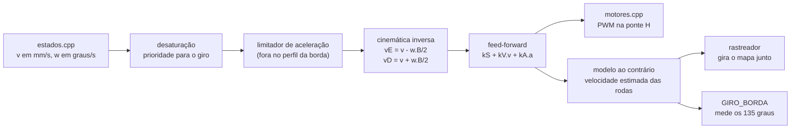
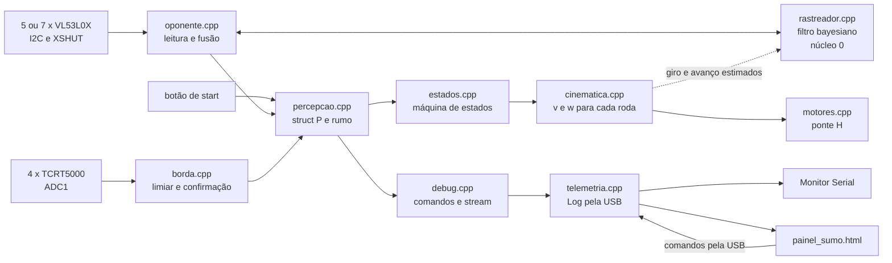
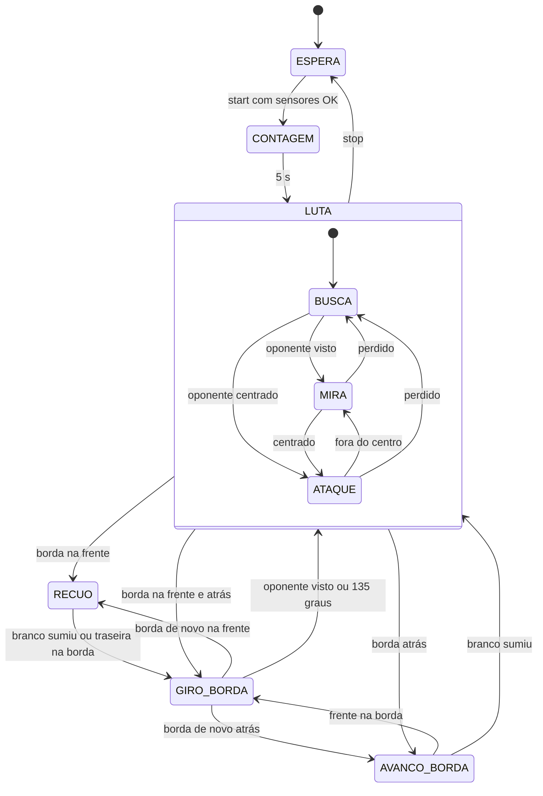

# Robô Sumô 1 kg com ESP32


[](https://github.com/felcoslop/LAB_III_Grupo_D_UFMG_2026_2/actions/workflows/compilacao.yml)
[](https://felcoslop.github.io/LAB_III_Grupo_D_UFMG_2026_2/)

Firmware e painel de telemetria do robô sumô autônomo da classe de 1 kg do **Grupo D**, desenvolvido na disciplina ELE635 Laboratório de Sistemas III da UFMG. O ESP32 lê cinco ou sete sensores de distância VL53L0X e quatro sensores de linha TCRT5000, estima onde está o oponente com um filtro bayesiano em grade e decide o movimento com uma máquina de estados. Um painel web, que abre direto no navegador e conversa com o robô pela USB, mostra sensores, mapa de probabilidade, rumo e estado em 2D e 3D.


## Sumário

- [Contexto](#contexto)
- [Funcionalidades](#funcionalidades)
- [Hardware](#hardware)
- [Cinemática das rodas](#cinemática-das-rodas)
- [Instalação](#instalação)
- [Uso](#uso)
- [Arquitetura](#arquitetura)
- [Mapa do código](#mapa-do-código)
- [Configuração](#configuração)
- [Estrutura de pastas](#estrutura-de-pastas)
- [Integração contínua](#integração-contínua)
- [Equipe](#equipe)
- [Referências](#referências)

## Contexto

O projeto faz parte da disciplina ELE635 Laboratório de Sistemas III, do curso de Engenharia de Sistemas da UFMG, no semestre 2026/2, com o Prof. Gustavo Medeiros Freitas. A disciplina cobre o ciclo completo de um projeto de engenharia, da concepção até a competição, e o robô segue a classe de 1000 g (Lego/Vex Sumô) das regras de sumô da RoboCore [ROBOCORE, s.d.a]: massa de até 1000 g, base de 15,2 x 15,2 cm, dojô (no código, dohyo) preto de 77 cm de diâmetro com borda branca de 2,5 cm, controle totalmente autônomo e início obrigatório 5 s depois do comando.

A versão atual roda em uma bancada de teste. Os sensores ficam presos em uma protoboard que faz o papel de chassi provisório, e o ESP32 fica ligado ao computador pela USB, que alimenta a placa e leva a telemetria. Nessa fase os motores ficam desligados no firmware (`USAR_MOTORES 0`), mas a máquina de estados roda normalmente e o painel mostra o comando que iria para cada roda.

## Funcionalidades

- Identificação dos VL53L0X (5 ou 7, escolhidos no `config.h`) pelo pino XSHUT, com endereço I2C próprio para cada sensor e nova tentativa automática quando algum para de responder.
- Leitura escalonada e sem bloqueio dos ToF, com mediana de 3 leituras e calibração de 2 pontos gravada na memória do ESP32.
- Rastreador bayesiano em grade polar, rodando no segundo núcleo, que aproveita também a informação dos sensores que não veem nada e reconhece a arena vazia.
- Rumo (a seta do painel) até o oponente ou até os pontos cegos, usado pela máquina de estados na busca.
- Leitura analógica da linha branca, com confirmação por tempo e calibração guiada em três medidas (ar, preto e branco).
- Máquina de estados com contagem obrigatória de 5 s, busca, mira, ataque e fuga da borda.
- Cinemática das duas rodas com o modelo do motor JGB37-520 e da ponte H: cada estado pede avanço em mm/s e giro em graus/s, a fuga da borda usa a tensão toda na hora e o firmware não compila se a distância de parada não couber na margem até as rodas. Os comandos `pwm` e `mov` testam os motores com o robô parado.
- Painel 2D e 3D em um único arquivo HTML, sem internet, ligado ao robô pela USB, com dados a 50 Hz e comandos pelo navegador.
- Firmware sem rádio: o robô compete de forma autônoma, sem WiFi e sem Bluetooth, o que deixa o núcleo 0 livre para o rastreador.
- Terminal de comandos pela USB ou pelo painel para teste, calibração e diagnóstico.

## Hardware

| Componente | Qtd. | Uso no projeto |
|---|---|---|
| ESP32 DevKit V1 (30 pinos) com placa de expansão | 1 | microcontrolador de dois núcleos, com ADC (o rádio fica desligado) |
| VL53L0X (placas CJVL53L0XV2 / GY-530) | 5 ou 7 | distância até o oponente: LE, FE, FC, FD e LD, mais TE e TD na versão de 7 |
| TCRT5000 com comparador LM393 | 4 | linha branca da borda, lida pela saída analógica A0 |
| Motor JGB37-520, 12 V, 319 rpm (redução de 18,8:1) | 2 | tração, com pneu StickyMAX S20 de 32 mm [ROBOCORE, s.d.b] |
| Bateria 3S de Li-ion (18650) com BMS | 1 | alimentação dos motores; o ESP32 tem bateria e conversor próprios |
| Módulo HW-956 de ponte H dupla de 10 A (3 a 18 V, entradas IN1 a IN4) | 1 | ponte H de MOSFET dos dois motores, com PWM de até 2 kHz (desativada na bancada) |
| Botão | 1 | start, ligado entre o GPIO 0 e o GND, em paralelo com o botão BOOT da placa |
| Chave DIP de 4 vias | 1 | ligada nos GPIOs 12, 14, 2 e 15; ainda sem uso no firmware |

| Função | GPIO | Observação |
|---|---|---|
| I2C SDA / SCL | 21 / 22 | barramento comum dos ToF, a 100 kHz |
| XSHUT LE / FE / FC / FD / LD | 17 / 23 / 19 / 18 / 5 | um fio por sensor, define o nome de cada um; o 5 é pino de boot e precisa de nível alto, o mesmo do XSHUT ligado |
| XSHUT TE / TD (só com 7 sensores) | 16 / 4 | sem restrição de boot |
| Borda BFE / BFD (frente) | 34 / 35 | ADC1, pinos só de entrada |
| Borda BTE / BTD (trás) | 32 / 33 | ADC1 |
| Ponte H IN1 / IN2 | 25 / 26 | motor esquerdo, com o PWM de 1 kHz no próprio IN |
| Ponte H IN3 / IN4 | 27 / 13 | motor direito |
| Botão de start | 0 | `INPUT_PULLUP`, nível baixo indica botão apertado; não pode estar apertado na hora de ligar |
| Chave DIP 1 a 4 | 12 / 14 / 2 / 15 | cada via liga o pino no 3V3 |

A pinagem segue o documento de ligação da placa nova (Lab3-Liga) e o esquema do Fritzing. Todos os sensores ficam no 3V3 do ESP32. As placas clone do VL53L0X puxam SDA e SCL para 2,8 V, nível que o ESP32 entende como 1, e o firmware nunca coloca nível alto no XSHUT: para desligar um sensor o pino vira saída em LOW e, para ligar, vira entrada com o pull-up interno. Os sensores de borda usam os pinos 34, 35, 32 e 33 do ADC1 e precisam do fio na saída A0 dos módulos; no esquema atual o fio sai do D0, que só entrega 0 ou 3,3 V e não separa arranhão de linha.

A chave DIP pede três cuidados. A DIP 1, no GPIO 12, precisa estar desligada na hora de ligar o ESP32, porque nível alto nesse pino durante o boot muda a tensão da memória flash e a placa não liga. A DIP 3, no GPIO 2, precisa estar desligada na hora de gravar o firmware. E o GPIO 2 deixou de acender o LED de status (`PINO_LED -1`): com a chave ligada e o pino em LOW, o 3V3 ficaria em curto com o pino.

Na bancada (`GEOMETRIA_BANCADA 1`), a origem do referencial é o centro da protoboard, com x para a frente e y para a esquerda, em milímetros:

| Sensor | XSHUT | Endereço | x | y | Ângulo |
|---|---|---|---|---|---|
| LE | 17 | 0x30 | -1 | 30 | 90° |
| FE | 23 | 0x31 | 73 | 27 | 20° |
| FC | 19 | 0x32 | 87 | -1 | 0° |
| FD | 18 | 0x33 | 73 | -27 | -20° |
| LD | 5 | 0x34 | -2 | -30 | -90° |
| TE (7 sensores, posição prevista) | 16 | 0x35 | -80 | 25 | 160° |
| TD (7 sensores, posição prevista) | 4 | 0x36 | -80 | -25 | -160° |

Os PDFs da pasta `doc/` trazem os gabaritos em escala 1:1 da bancada e do robô, o mapa de ligação na protoboard e uma lista de conferência antes de energizar. O `guia_montagem_sensores_7.pdf` faz o mesmo para a versão de 7 sensores e traz também a pinagem completa do ESP32.

### Posição dos sensores: 5 ou 7

A constante `QTD_TOF` do `config.h` escolhe entre os 5 sensores originais e a versão de 7, que acrescenta um par nas quinas de trás (TE e TD a ±160°). Os 5 sensores de antes não mudam: FC no centro, que é quem decide o ataque, FE e FD a ±20° e LE e LD a ±90°. O par novo fica no fim da tabela, então os 5 sensores de antes mantêm XSHUT, endereço, cor no painel e calibração gravada; com `QTD_TOF 5` o firmware compilado é idêntico ao anterior.

O capítulo 2 do Sumo Robot Blackbook pede número ímpar de sensores, com um no centro para centralizar o oponente, e diz que os sensores precisam vigiar todas as áreas por onde o oponente pode atacar, principalmente os cantos [DEDE, s.d.]. O exemplo de 7 do livro acrescenta duas diagonais na frente, mas o livro não trata de sensores atrás. Com os 5 sensores de hoje, a frente já enxerga bem: o buraco entre FE e LE (de 32,5° a 77,5°) só existe a mais de uns 25 cm, porque os cones se cruzam perto do robô, e o oponente que vem por ali entra em algum cone antes de encostar. A traseira, de 115° a 180°, não tem nenhum sensor. Com o par atrás, o total continua ímpar, o FC continua sozinho no centro e a área sem cobertura passa a ser vigiada.

A escolha saiu de uma simulação com o rastreador do firmware compilado no computador, robô de 152 mm e oponente preto de 15,2 cm: 500 ataques em linha reta a 0,4 a 1,2 m/s com o robô parado, 300 buscas seguindo o rumo do firmware a partir de posições sorteadas dentro do dojô e 240 sequências de rastreio com o oponente andando.

| Robô de 152 mm | 5 (hoje) | 7, par na frente a ±45° | 7, par atrás a ±160° |
|---|---|---|---|
| Ataques que chegam sem ser vistos | 36% | 36% | 8% |
| Ataques por trás que chegam sem ser vistos | 83% | 82% | 9% |
| Tempo médio de busca com o oponente parado (90% dos casos) | 206 ms (700 ms) | 185 ms (660 ms) | 35 ms (140 ms) |
| Tempo médio de busca com o oponente andando (90% dos casos) | 317 ms (922 ms) | 268 ms (880 ms) | 34 ms (120 ms) |
| Erro de ângulo na frente, 90% dos casos | 7,5° | 6,1° | 7,5° |
| Posições do dojô dentro de algum cone | 58% | 64% | 88% |

O par na frente melhora um pouco a mira nas diagonais, mas não muda o que passa sem ser visto. O par atrás reduz os ataques sem aviso de 36% para 8% e deixa a busca cerca de 6 vezes mais rápida, sem mudar a precisão na frente. O ângulo de ±160° veio de uma varredura: com o par a ±140°, ±150°, ±160° e ±170°, os ataques por trás sem aviso ficaram em 17%, 12%, 9% e 8%, e a ±170° o ganho é pequeno e o aviso chega mais tarde. Os pontos sem cobertura que restam são o buraco diagonal a mais de 25 cm e uma faixa estreita bem atrás a mais de 30 cm. Esses números são de simulação; o teste na bancada com o painel é o que confirma o ganho.


Com a pinagem da placa nova, os únicos GPIOs livres são o 36 e o 39, que servem só como entrada e não podem acionar um XSHUT. Um 8º sensor precisaria de um pino da chave DIP ou de um expansor I2C, como o PCF8574, e ainda deixaria o número de sensores par, o que o livro desaconselha [DEDE, s.d.].

## Cinemática das rodas

O robô tem duas rodas de tração, uma de cada lado, e anda como um robô diferencial: com as duas rodas na mesma velocidade ele segue reto, com velocidades diferentes ele faz curva e com velocidades opostas ele gira no eixo. A máquina de estados não trabalha com PWM. Cada estado pede um avanço `v`, em mm/s, e um giro `w`, em graus/s (positivo para a esquerda, o mesmo sentido dos ângulos dos sensores), e o módulo `cinematica.cpp` transforma o pedido no PWM de cada lado da ponte H. A origem do referencial fica no meio do eixo das rodas, então o ângulo do oponente que sai do rastreador já é o giro que o robô precisa fazer.



### Simulador na web

A página [https://felcoslop.github.io/LAB_III_Grupo_D_UFMG_2026_2/](https://felcoslop.github.io/LAB_III_Grupo_D_UFMG_2026_2/) roda no navegador as mesmas contas do `cinematica.cpp` e da máquina de estados: o dojô aparece visto de cima, o oponente pode ser arrastado com o mouse e o botão Rodar mostra, a cada instante, o pedido do estado, a desaturação, o limitador, a cinemática inversa, o feed-forward e o PWM de cada roda, junto com o caminho do robô e a fuga da borda. Embaixo, a página refaz a conta da distância de parada para qualquer tensão de bateria e qualquer atrito. O código da página fica em `doc/site/index.html`; o workflow `pages.yml` publica a página no GitHub Pages a cada mudança na `main`, e o CI roda o `doc/confere_site.py` em todo pull request para garantir que as constantes da página continuam iguais às do `config.h`.

[](https://felcoslop.github.io/LAB_III_Grupo_D_UFMG_2026_2/)

### Modelo do motor

A base do modelo é a tabela do fabricante para a linha de 12 V e 319 rpm do JGB37-520 [RCDRONE, s.d.] e a medida do pneu [ROBOCORE, s.d.b]. O esquema da placa mostra um L298N, mas a ponte usada é um módulo de 10 A com transistores MOSFET, que perde só alguns décimos de volt; um L298N perderia de 1,8 a 3,2 V com 1 A [STMICROELECTRONICS, s.d.]. O anúncio do motor fala em 21 kgf.cm, valor que não fecha com a corrente de 1,2 A nem com a redução de 18,8:1 e por isso ficou de fora.

| Dado | Valor | Origem |
|---|---|---|
| Rotação livre a 12 V | 319 rpm | tabela do motor |
| Redução | 18,8:1 | tabela do motor |
| Corrente livre e com o eixo travado | 0,1 A e 1,2 A | tabela do motor |
| Torque com o eixo travado | 1,9 kgf.cm (0,19 N.m) | tabela do motor |
| Tensão de partida | 1,5 V | tabela do motor |
| Queda na ponte H | cerca de 0,2 V | estimada para a ponte de MOSFET, precisa de medida |
| Diâmetro da roda | 32 mm | pneu StickyMAX S20 |
| Bitola (centro a centro das rodas) | 132 mm | gabarito do robô, precisa de medida no chassi |

O modelo do motor é uma reta de tensão por velocidade que passa pelos dois pontos da tabela: 1,5 V para sair do lugar e 319 rpm livre com 12 V. Com a bateria 3S em 11,1 V e 0,2 V perdidos na ponte H, o motor recebe 10,9 V com PWM de 100%:

| Resultado do modelo | Valor |
|---|---|
| Velocidade máxima em linha reta | 478 mm/s (cerca de 555 mm/s com a bateria cheia) |
| Giro máximo no eixo | 415 graus/s, meia volta em 0,43 s |
| kS, kV e kA de cada roda | 1,5 V; 19,6 mV por mm/s; 1,25 mV por mm/s² |
| Força no chão na partida, por roda | 3,9 N, no limite dos 3,9 N que o atrito permite com atrito 1 |
| Distância de parada na borda, no pior caso | 38 mm |

Esses números corrigem três valores antigos do `config.h`, que estavam marcados como "precisa ser medido". O rastreador girava o mapa a 600 graus/s com PWM máximo, quase 45% acima do giro real, e andava com ele a 1500 mm/s, mais de três vezes a velocidade real. E o giro de fuga da borda, de 250 ms com PWM 200, dava só uns 80 graus, e não os 135 graus do comentário.

### Do pedido ao PWM

Cada volta do loop passa o pedido da máquina de estados por quatro etapas:

1. Desaturação com prioridade para o giro. Quando avanço e giro juntos passam da velocidade máxima de uma das rodas, o avanço diminui e o giro fica. O linorobot2_hardware reduz os dois na mesma proporção [JIMENO, 2021]; no sumô a mira vale mais que a velocidade, porque um robô que chega rápido e torto entrega a lateral para o oponente.
2. Limitador de aceleração, no estilo do SpeedLimiter do diff_drive_controller [ROS-CONTROLS, s.d.], com 6 m/s², perto do limite de tração. O limite segura as reversões bruscas, quando a corrente do motor chega a 2 A e a roda patina, e também a partida, que com a ponte de MOSFET fica no limite da tração. O perfil da fuga da borda não passa por ele.
3. Cinemática inversa do diff_drive_controller [ROS-CONTROLS, s.d.]: a roda esquerda anda `v - w.B/2` e a direita `v + w.B/2`, com B a bitola.
4. Feed-forward do SimpleMotorFeedforward do WPILib [WPILIB, s.d.]: a tensão de cada roda é `kS.sinal(v) + kV.v + kA.a`, dividida pela tensão que chega no motor. O kS vence o atrito de partida; sem ele, um pedido de 5 mm/s viraria PWM 2 e a roda nem sairia do lugar.

O JGB37-520 deste projeto não tem encoder. Por isso o mesmo modelo, rodado ao contrário, estima a velocidade real de cada roda a partir do PWM aplicado, com o atraso de 60 ms do motor. A estimativa entra no rastreador, que gira o mapa de probabilidade junto com o robô, e mede o giro de recuperação na borda.

### Cada estado em avanço e giro

| Estado | Avanço `v` | Giro `w` | Perfil |
|---|---|---|---|
| BUSCA sem pista | 0 | 200 graus/s para o lado do rumo | normal |
| BUSCA com o oponente provável à frente, ou no avanço curto | 240 mm/s | 0 | normal |
| MIRA até 40 graus | `VEL_MAX.cos(ângulo)` | `6.ângulo`, até 370 graus/s | normal |
| MIRA acima de 40 graus | 0 | 370 graus/s para o lado do oponente | normal |
| ATAQUE | `VEL_MAX` | `6.ângulo` (correção) | normal |
| RECUO | `-VEL_MAX` | 0 | borda |
| AVANCO_BORDA | `VEL_MAX` | 0 | borda |
| GIRO_BORDA | 0 | 370 graus/s, até 135 graus estimados | normal |

A mira é proporcional: o giro pedido é 6 graus/s para cada grau de erro, e o erro cai a 37% em cerca de 0,17 s. Com o oponente a 20 graus para a esquerda, por exemplo, a mira pede 120 graus/s de giro e 450 mm/s de avanço. Os dois juntos não cabem nas rodas, então a desaturação baixa o avanço para 340 mm/s e as rodas ficam em 202 mm/s (esquerda) e 478 mm/s (direita): uma curva fechada para o oponente, sem perder a mira. No ataque, a mesma correção mantém o oponente no centro enquanto o robô empurra.

### A borda vem antes de tudo

O RECUO e o AVANCO_BORDA usam o perfil da borda: sem limitador e com a tensão toda no sentido da fuga já na primeira volta do loop. No pior caso, com a bateria cheia e o robô a 555 mm/s, o robô percorre uns 3 mm durante os 6 ms de confirmação da borda e da volta do loop e mais 35 mm freando com a roda patinando para trás (atrito 0,7 e 80% do peso nas rodas), cerca de 38 mm no total. A margem é a faixa branca de 25 mm somada à distância entre o sensor de borda e o eixo das rodas, 60 mm no robô, ou seja, 85 mm. O `cinematica.cpp` faz essa conta durante a compilação (`static_assert`): um motor mais rápido, uma roda maior ou uma bateria com mais tensão que quebrem a margem param a compilação com uma mensagem de erro. Na frenagem mais longa, a ponta da lâmina pode passar da borda do dojô por um instante, mas as rodas ficam sempre a mais de 45 mm dela.

O giro de recuperação (GIRO_BORDA) também mudou. Antes ele durava um tempo fixo e ignorava a borda; agora ele termina quando a cinemática estima 135 graus, com 900 ms como limite de segurança, e continua vigiando a borda: uma quina que volta ao branco no meio do giro, ou um empurrão do oponente, leva o robô de novo ao RECUO ou ao AVANCO_BORDA.

### Acerto do modelo com o robô montado

Os valores marcados com "medir" no `config.h` ficam certos só com o robô montado. O capítulo 11 do Blackbook manda medir as primitivas de movimento antes de montar qualquer tática: a distância percorrida em um tempo fixo e o tempo de uma volta completa no eixo [DEDE, s.d.]. O comando `cin` mostra os números do modelo, e o comando `mov V W MS` faz o robô parado em ESPERA andar com avanço V e giro W por MS milissegundos e, no fim, mostra a distância e o giro estimados. Com `mov 300 0 1000`, a distância medida com a régua, comparada com a estimada, acerta o `MOTOR_RPM_LIVRE` ou a `PONTE_QUEDA_V`; com `mov 0 300 1000`, o giro medido no chão acerta a `BITOLA_MM`. Qualquer borda vista interrompe o teste na hora. Antes disso, o comando `pwm E D MS` confere os fios: cada roda recebe a porcentagem de PWM pedida (de -100 a 100, positivo para a frente), sem passar pela cinemática. Com `pwm 30 0 1000` só a roda esquerda precisa girar, para a frente; roda ao contrário se corrige com `INVERTE_ESQ` ou `INVERTE_DIR` e rodas trocadas com `TROCA_MOTORES`. Os dois testes funcionam com os sensores desligados, porque rodam no estado ESPERA, e durante eles o firmware não tenta religar os ToF.

## Instalação

### Requisitos

| Item | Versão | Observação |
|---|---|---|
| Arduino IDE | 1.8.x ou 2.x | |
| Core ESP32 da Espressif | 2.x ou 3.x | Gerenciador de Placas, pacote "esp32 by Espressif Systems" |
| Biblioteca VL53L0X da Pololu | 1.3.1 | Gerenciador de Bibliotecas |
| Python 3 | 3.x | necessário só para gerar o painel de novo |

O firmware usa o core do ESP32 [ESPRESSIF SYSTEMS, s.d.] e a biblioteca VL53L0X da Pololu [POLOLU, s.d.]. As bibliotecas Preferences e Wire já vêm com o core.

### Passo a passo

1. Extração do zip em uma pasta chamada `sumo_esp32`. A Arduino IDE exige que o nome da pasta seja igual ao do arquivo `.ino`, e o "Extrair tudo" do Windows usa o nome do zip, então `sumo_esp32.zip` já gera a pasta certa. Em um clone do repositório, o nome da pasta precisa do mesmo cuidado, por exemplo com `git clone https://github.com/felcoslop/LAB_III_Grupo_D_UFMG_2026_2 sumo_esp32`.
2. Abertura do `sumo_esp32.ino` na IDE. Os outros arquivos `.h` e `.cpp` aparecem como abas.
3. Ajustes no menu Ferramentas, conforme a tabela abaixo.
4. Compilação e gravação pela USB, com o botão Carregar.
5. Monitor Serial em 115200 baud, com a opção "Nova linha".

| Opção em Ferramentas | Valor |
|---|---|
| Placa | ESP32 Dev Module |
| Partition Scheme | padrão (o firmware cabe com folga) |
| Porta | porta COM do ESP32 |

## Uso

### Primeiro teste pela USB

No boot, o terminal mostra a lista de comandos e a tabela de sensores. O comando `lista` deve mostrar todos os ToF como OK; com menos de três, o robô não inicia e o LED azul pisca rápido. O comando `scan` deve encontrar os endereços de 0x30 a 0x34 (até 0x36 com 7 sensores), e um endereço 0x29 indica um sensor sem o fio XSHUT. No modo `id`, a mão cobrindo um sensor por vez faz o terminal escrever o nome dele, o que ajuda a conferir as etiquetas e a cor de cada fio.

### Comandos

Os comandos funcionam no Monitor Serial e no terminal do painel.

| Comando | Descrição |
|---|---|
| `help` ou `?` | lista de comandos |
| `lista` | sensores configurados, calibração e status |
| `id` | modo de identificação: o nome do sensor coberto aparece no terminal |
| `ver` | leitura contínua de sensores, oponente, borda, rumo, estado e motores |
| `scan` | endereços I2C presentes no barramento |
| `cal NOME [P1 P2]` | calibração de 2 pontos do ToF (padrão 50 e 300 mm), gravada no ESP32 |
| `calver` | ganho e offset de cada ToF |
| `calzera NOME` ou `calzera todos` | remoção da calibração gravada |
| `medir NOME MM` | conferência da calibração: média, ruído e erro com o alvo a MM milímetros |
| `borda` | leitura contínua dos sensores de borda (mV e limiar) |
| `calborda` | diagnóstico e calibração da borda em três medidas |
| `bordazera` | remoção da calibração da borda |
| `init` | nova tentativa nos ToF que falharam, com o robô parado |
| `tempo` | duração do ciclo do loop, tempo do rastreador e linhas descartadas na USB |
| `cin` | números do modelo das rodas: velocidade e giro máximos, feed-forward e distância de parada |
| `mov V W MS` | teste com o robô parado: avanço V mm/s e giro W graus/s por MS ms (até 3000), com a estimativa no fim |
| `pwm E D MS` | teste dos fios: PWM direto de E% na roda esquerda e D% na direita (-100 a 100) por MS ms |
| `go` e `stop` | início (contagem de 5 s) e parada da máquina de estados |
| `s1` e `s0` | stream de dados para o painel, ligado e desligado |

### Painel pela USB

O arquivo `painel_sumo.html` abre direto no Chrome ou no Edge do computador, sem internet, porque o three.js está embutido nele [THREE.JS, 2022]. O botão "Conectar USB" usa a Web Serial do navegador a 115200 baud; logo depois de abrir a porta, o painel envia `s1` e passa a receber os dados a 50 Hz. O Monitor Serial da IDE precisa estar fechado, porque só um programa por vez usa a porta. O botão "Modo demo" simula um oponente preto de 15,2 cm e roda em JavaScript o mesmo rastreador do firmware; o quadrado pode ser arrastado no radar 2D e, com a opção "robô se mexe", o robô simulado obedece à seta.

| Oponente à vista (rumo ATACAR) | Arena vazia (rumo PROCURAR) |
|---|---|
|  |  |

No radar, cada cone colorido é um sensor, a mancha laranja é o mapa de probabilidade do rastreador, o quadrado vermelho é o oponente na posição estimada e a seta é o rumo entregue para a máquina de estados. O círculo cinza é a borda simulada do dojô no modo demo.

### Calibração

A distância do VL53L0X tem um erro fixo de fábrica que a biblioteca não corrige, e nas placas clone esse erro fica entre +10 e +30 mm. O comando `cal FC` pede um alvo plano e fosco a 50 mm e depois a 300 mm da face do chip; o ganho e o offset calculados ficam gravados na memória não volátil do ESP32 e continuam valendo depois de desligar. O comando `medir FC 100` confere o erro que sobrou.

Os sensores de borda passam pelo `calborda`. A medida no ar revela reflexo indesejado, como o da lateral branca da protoboard, e as medidas no preto e no branco definem a polaridade e o limiar. O limiar fica a 35% do caminho entre o branco e o preto, mais perto do branco, para arranhão e poeira não dispararem a borda [DEDE, s.d.]. Sem calibração vale o limiar fixo de 600 mV, e o `lista` avisa quando isso acontece.

### Teste da máquina de estados

O comando `go` (ou o botão de start) inicia a contagem de 5 s e depois a luta. Na bancada, com `USAR_MOTORES 0`, nenhum pino de motor muda, mas o modo `ver` e o painel mostram o estado atual, o PWM e a velocidade estimada de cada roda. O teste consiste em mover um objeto em volta dos sensores e acompanhar as trocas entre BUSCA, MIRA e ATAQUE. O comando `stop` volta para ESPERA.

## Arquitetura

O firmware segue uma regra simples: a máquina de estados só conhece a struct `P` (percepção). Os módulos de sensores escrevem em `P`, a estratégia lê `P` e manda nos motores, e o debug e a telemetria mostram tudo. Com essa separação, um sensor novo entra sem mexer na estratégia, e a estratégia pode ser testada com `P` preenchida à mão.



Nenhum módulo usa `delay()` dentro do loop. Cada volta chama os módulos na ordem abaixo, e cada um faz uma parte pequena do trabalho e devolve o controle.

| Ordem | Chamada | Arquivo | Papel |
|---|---|---|---|
| 1 | `percepcao_atualiza()` | percepcao.cpp | leitura dos sensores, fusão, rumo e montagem de `P` |
| 2 | `estados_passo()` | estados.cpp e cinematica.cpp | decisão, cinemática das rodas e comando dos motores |
| 3 | `percepcao_manutencao()` | percepcao.cpp | nova tentativa nos ToF que caíram, só em ESPERA |
| 4 | `debug_passo()` | debug.cpp | comandos e envio de dados para o painel |

O ESP32 tem dois núcleos. O loop do Arduino roda no núcleo 1, e o rastreador bayesiano, que leva alguns milissegundos por passo, roda em uma tarefa do FreeRTOS no núcleo 0. Como o firmware não liga o rádio, a pilha do WiFi não disputa esse núcleo com o rastreador. A troca de dados entre os dois acontece dentro de uma trava curta (spinlock), então o loop nunca espera o filtro terminar.

O referencial é o mesmo em todo o código: origem no centro de giro do robô, x para a frente, y para a esquerda e ângulo positivo para a esquerda. Com isso, o ângulo do oponente já é o quanto o robô precisa girar.

## Mapa do código

### `sumo_esp32.ino`

Arquivo principal. O `setup()` configura primeiro os motores, para o robô nascer parado, cria um buffer de 4 KB na serial e inicializa percepção, máquina de estados e debug. O `loop()` apenas chama os módulos na ordem da tabela de arquitetura.

### `config.h`

Este arquivo concentra tudo o que depende do hardware: pinos, posição dos sensores, limiares, velocidades e tempos. As tabelas `TOF[]` e `BORDA[]` descrevem os sensores, e o tamanho delas sai de `sizeof`, então um sensor a mais é só uma linha a mais na tabela (até 16 ToF). A chave `GEOMETRIA_BANCADA` escolhe entre as posições da bancada e as do robô, e a `QTD_TOF` escolhe entre 5 e 7 sensores; qualquer outro valor interrompe a compilação com uma mensagem de erro. O alcance `TOF_ALCANCE_MM` vem da geometria do dojô: no pior caso, com o robô encostado em uma borda e o oponente encostado na borda oposta, a face do oponente fica a 77 cm menos 7,6 cm menos 15,2 cm, ou seja, 54,2 cm do centro do robô. Qualquer leitura mais longe é parede, mesa ou pessoa e vale como "nada".

### `percepcao.h` e `percepcao.cpp`

Estes arquivos definem a struct `P` e as partes dela: `op` (oponente), `rumo`, `borda`, `saude`, o evento `start` e o instante `t_ms`. A função `percepcao_atualiza()` mede a duração do ciclo, chama a leitura e a fusão dos ToF, calcula o rumo, lê a borda, atualiza a saúde dos sensores e trata o botão de start com debounce de 30 ms. A `percepcao_manutencao()` tenta religar os ToF que falharam a cada 2 s, somente com o robô parado, porque essa operação bloqueia por alguns milissegundos.

O rumo é a direção que o robô deve seguir agora e aparece no painel como uma seta:

| Modo | Quando | Ângulo | Cor da seta |
|---|---|---|---|
| ATACAR | oponente visto e centrado | até o oponente | vermelha |
| MIRAR | oponente visto fora do centro | até o oponente | laranja |
| PROVÁVEL | oponente perdido há pouco, mapa ainda concentrado | até onde ele provavelmente está | amarela |
| PROCURAR | sem pista | giro que leva os cones aos pontos cegos | azul |

### `oponente.h` e `oponente.cpp`

Módulo dos VL53L0X, com três tarefas. A primeira é a inicialização: todos os sensores começam desligados pelo XSHUT, e cada um é ligado sozinho, responde no endereço de fábrica 0x29 e recebe o endereço da tabela. A segunda é a leitura: os sensores medem em modo contínuo a cada 20 ms e o código só consulta cada um perto da hora de ter medida nova, o que deixa o barramento I2C livre; a leitura passa pela calibração `ganho * bruto + offset`, pela mediana das 3 últimas medidas e pelo alcance de cada sensor. A terceira é a fusão: com `FUSAO_BAYES 0` as leituras do mesmo objeto viram um ponto médio, e com `FUSAO_BAYES 1` (padrão) as medidas vão para o rastreador. Um sensor só é marcado como FALHOU depois de erros repetidos de I2C, então uma pausa longa do loop não derruba um sensor bom.

### `rastreador.h` e `rastreador.cpp`

Filtro bayesiano em grade (filtro de histograma) para um único oponente quadrado de 15,2 cm [THRUN; BURGARD; FOX, 2005]. O mapa guarda a probabilidade de o centro do oponente estar em cada célula de uma grade polar de 120 direções de 3° por anéis de 20 mm, a partir de 150 mm do centro do robô. Tudo o que depende só da geometria (o que cada sensor deveria ler para cada célula) é calculado uma vez no boot, então durante a luta sobram multiplicações com tabelas, sem trigonometria. A cada medida nova o filtro passa por quatro etapas:

1. Predição: o mapa espalha um pouco, porque o oponente pode ter andado até 1,5 m/s e o robô pode ter girado; com o giro conhecido pelos motores, o mapa também gira junto.
2. Correção: cada sensor confirma as células em que a face do oponente ficaria na distância lida, e um sensor sem leitura desmente as células no meio do próprio cone (informação negativa).
3. Regra: células dentro do corpo do robô valem zero e uma pequena mistura uniforme permite reencontrar o oponente se o mapa errar.
4. Existência: uma probabilidade separada indica se existe oponente no alcance, e ela só sobe quando as leituras aparecem repetidas e coerentes. Por isso a arena vazia quase nunca gera oponente falso.

A estimativa final traz ângulo, distância, posição, incerteza (sigma), concentração do mapa, chance de existir e o giro de busca. O giro de busca sai de uma avaliação de vários giros possíveis, de 6 em 6 graus para cada lado: para cada um, o código soma quanto do mapa os cones vão varrer e divide pelo tempo de girar, e o melhor vira o rumo PROCURAR. O resultado é que o robô olha primeiro os pontos cegos onde o oponente pode estar.

### `borda.h` e `borda.cpp`

Leitura dos quatro TCRT5000 pela saída analógica, em milivolts, seguindo a recomendação de leitura analógica com limiar de tempo do Blackbook [DEDE, s.d.]. Cada sensor tem um limiar calculado a partir da calibração (ou o valor fixo do `config.h`) e um contador de leituras seguidas no branco. A borda só é confirmada com branco contínuo por pelo menos 3 ms e duas leituras, o que descarta arranhões; a linha de 2,5 cm passa em uns 25 ms com o robô a 1 m/s, então sobra margem. No final, a máscara de sensores confirmados vira as informações de lado, frente e trás usadas pela máquina de estados.

### `estados.h` e `estados.cpp`

Máquina de estados da estratégia. A borda tem prioridade sobre tudo durante a luta, e o ataque só acontece com o sensor central vendo o oponente centrado (até 7°), como recomenda o Blackbook [DEDE, s.d.]. O recuo da borda dura enquanto o sensor vê branco e mais uma folga de 10 ms, e o giro de recuperação continua vigiando o oponente e a borda. Cada estado pede avanço e giro para a cinemática, como mostra a seção [Cinemática das rodas](#cinemática-das-rodas).



No diagrama, LUTA agrupa BUSCA, MIRA e ATAQUE. A saída de GIRO_BORDA cai em ATAQUE, MIRA ou BUSCA, conforme o oponente esteja centrado, visto ou perdido, e a saída de AVANCO_BORDA cai em BUSCA. O comando `stop` leva qualquer estado para ESPERA.

Na BUSCA, o robô gira no eixo a 170 graus/s para o lado do rumo; depois de 1,5 s girando sem pista (rumo PROCURAR), avança a 200 mm/s por 0,25 s para mudar o ponto de vista e volta a girar. Quando o rumo é PROVÁVEL e o oponente deve estar bem à frente (até 12°), o robô avança em vez de girar. Com `MODO_DEFENSIVO 1`, o robô só gira e mira, sem avançar.

### `motores.h` e `motores.cpp`

Controle do módulo HW-956 (ponte H dupla de 10 A), com valores de -255 a 255 por roda. O PWM vai no próprio pino IN: para a frente o IN1 recebe o PWM e o IN2 fica em LOW, e para trás o contrário. Com comando 0 os dois pinos ficam em LOW e o motor para. O PWM sai do periférico LEDC do ESP32 a 1 kHz (`PWM_MOTOR_HZ`), abaixo do limite de 2 kHz do módulo. A configuração do LEDC acontece uma vez só no `motores_init()`, e depois disso cada comando só troca o duty. O `analogWrite` ficou de fora porque, no core 2.x, cada chamada dele zera o contador do PWM, e com o loop rodando em microssegundos o sinal no pino deixa de seguir o comando. O anúncio do módulo pede parada antes de inverter o sentido, por causa do pico de corrente; com o JGB37-520 esse pico fica perto de 2,4 A por motor na inversão em velocidade máxima, bem abaixo dos 10 A do módulo, e a fuga da borda inverte na hora. As chaves `INVERTE_ESQ` e `INVERTE_DIR` corrigem um motor ligado ao contrário e a `TROCA_MOTORES` corrige os dois motores trocados de saída, sem mexer nos fios. Com `USAR_MOTORES 0`, o módulo só guarda o último comando, que aparece no debug.

### `cinematica.h` e `cinematica.cpp`

Cinemática das rodas e modelo do acionamento, descritos na seção [Cinemática das rodas](#cinemática-das-rodas). A função `cinematica_comanda(v, w, perfil)` recebe o avanço em mm/s e o giro em graus/s e manda o PWM para o `motores.cpp`; o perfil `PERFIL_BORDA` pula o limitador e usa a tensão toda. As funções `cinematica_v_mms()` e `cinematica_w_dps()` devolvem a velocidade estimada pelo modelo, usada pelo rastreador, e a `cinematica_giro()` devolve o giro acumulado, usado no GIRO_BORDA e no comando `mov`. As constantes derivadas do `config.h` (velocidade e giro máximos, kS, kV, kA e distância de parada) ficam no `cinematica.h`, e a conta da distância de parada é conferida na compilação.

### `telemetria.h` e `telemetria.cpp`

Saída de texto e entrada de comandos pela USB. O objeto `Log` substitui o `Serial` em todo o projeto: cada linha sai inteira, o que deixa o painel ler sem pedaços misturados. As linhas de dados (`D`, `Q` e `M`) são descartadas quando o buffer da serial está cheio, então o robô nunca fica esperando a USB; o comando `tempo` mostra quantas linhas foram descartadas. A função `entrada_le()` entrega ao debug os caracteres que chegam do Monitor Serial ou do painel.

### `debug.h` e `debug.cpp`

Comandos de teste e calibração, os modos contínuos (`ver`, `id`, `borda`) e o stream para o painel. Este módulo conversa com todos os outros, porque precisa mostrar tudo. Os dados para o painel seguem um protocolo de texto simples, com uma letra no início de cada linha:

| Linha | Conteúdo | Quando |
|---|---|---|
| `G`, `I`, `C` | geometria, status e calibração de cada ToF | comando `s1`, enviado pelo painel ao conectar |
| `R` | posição, limiar e calibração de cada sensor de borda | comando `s1` e depois de cada calibração |
| `B`, `E`, `K`, `X` | corpo do robô, nomes dos estados, alcance e parâmetros do rastreador | comando `s1` |
| `D` | leituras, oponente, estado, saúde, incerteza, existência e rumo | a cada 20 ms |
| `Q` | borda confirmada, borda crua e mV de cada sensor | a cada 20 ms |
| `M` | mapa de probabilidade comprimido | a cada 250 ms |

### Painel

O `painel_sumo.html` é o painel completo, com o three.js e o OrbitControls embutidos. O código fonte fica em `doc/painel_src.html`, e o script `doc/gera_painel.py` junta o fonte com as bibliotecas de `doc/vendor/` e gera o `painel_sumo.html`. Qualquer mudança no painel exige rodar `python doc/gera_painel.py` e fazer o commit dos dois arquivos; o CI confere se eles estão iguais.

### Documentos de montagem

A pasta `doc/` traz o `gabarito_bancada.pdf` (bancada em escala 1:1, vista lateral, cotas e montagem dos sensores de borda) , o `guia_montagem_sensores.pdf` (gabarito do robô, mapa de ligação na protoboard e lista de conferência) e o `guia_montagem_sensores_7.pdf`, com a mesma estrutura para 7 sensores mais o gabarito da bancada com o par novo, a pinagem completa do ESP32 e o estudo de cobertura. Os scripts `gera_bancada.py` e `gera_guia.py` geram esses PDFs a partir das tabelas do `config.h` com a biblioteca ReportLab (`python doc/gera_guia.py --sensores 7` gera a versão de 7).

## Configuração

Os ajustes principais ficam no `config.h`:

| Constante | Valor | Efeito |
|---|---|---|
| `GEOMETRIA_BANCADA` | 1 | 1 usa as posições da bancada e 0 as do robô |
| `QTD_TOF` | 5 | quantidade de sensores de oponente, 5 ou 7 (também aceita `-DQTD_TOF=7` na compilação) |
| `I2C_CLOCK_HZ` | 100000 | velocidade do I2C; 400000 só com fios curtos |
| `TOF_TIMING_US` | 20000 | tempo de cada medida do ToF |
| `TOF_ALCANCE_MM` | 542 (calculado) | alcance máximo a partir do centro do robô |
| `TOF_MINIMO_PARA_LUTAR` | 3 | quantidade mínima de ToF para o robô iniciar |
| `CENTRO_DEG` | 7 | ângulo máximo para o oponente contar como centrado |
| `FUSAO_BAYES` | 1 | 1 usa o rastreador e 0 a fusão simples |
| `OPONENTE_LADO_MM` | 152 | lado do oponente, pela regra da classe |
| `ALCANCE_PRETO_MM` | 550 | distância até onde o ToF vê um robô preto sem falhar |
| `OP_VEL_MAX_MMS` | 1500 | velocidade máxima considerada para o oponente |
| `RASTREADOR_NUCLEO` | 0 | núcleo da tarefa do rastreador; -1 roda dentro do loop |
| `BORDA_LIMIAR_MV` | 600 | limiar fixo da borda antes da calibração |
| `BORDA_FRACAO` | 0,35 | posição do limiar calibrado entre o branco e o preto |
| `BORDA_CONFIRMA_MS` | 3 | tempo mínimo de branco contínuo para confirmar a borda |
| `USAR_BORDA` e `USAR_MOTORES` | 1 e 0 | liga e desliga cada parte do hardware |
| `STREAM_MS` | 20 | intervalo dos dados enviados ao painel pela USB |
| `MOTOR_RPM_LIVRE`, `MOTOR_V_PARTIDA` e `MOTOR_KA` | 319, 1,5 e 1,25 | modelo do motor (tabela do JGB37-520; o kA precisa de medida) |
| `BATERIA_V` e `PONTE_QUEDA_V` | 11,1 e 0,2 | tensão que chega no motor com PWM de 100% |
| `RODA_DIAMETRO_MM` e `BITOLA_MM` | 32 e 132 | roda e distância entre as rodas (a bitola precisa de medida) |
| `ACEL_MAX_MMS2` e `FREIO_MIN_MMS2` | 6000 e 4400 | limite de aceleração das manobras e pior frenagem na borda |
| `VEL_BUSCA_MMS` e `GIRO_BUSCA_DPS` | 240 e 200 | avanço curto e giro da busca |
| `K_MIRA`, `ANG_MIRA_CURVA` e `GIRO_MIRA_MAX_DPS` | 6, 40 e 370 | ganho da mira, ângulo até onde a mira é curva e giro máximo da mira |
| `GIRO_BORDA_DPS`, `ANG_GIRO_BORDA` e `T_GIRO_BORDA_MAX_MS` | 370, 135 e 900 | giro de recuperação na borda e limite de segurança |
| `T_CONTAGEM_MS` | 5000 | contagem obrigatória antes da luta |
| `T_BUSCA_GIRO_MS` e `T_BUSCA_AVANCO_MS` | 1500 e 250 | tempo girando na busca e tempo do avanço curto |
| `MODO_DEFENSIVO` | 0 | 1 faz o robô só mirar, sem avançar |

## Estrutura de pastas

```
sumo_esp32/
  sumo_esp32.ino            arquivo principal (setup e loop)
  config.h                  pinos, sensores, limiares, velocidades e tempos
  percepcao.h / .cpp        struct P, rumo, saúde e botão de start
  oponente.h / .cpp         VL53L0X: endereço, leitura, calibração e fusão
  rastreador.h / .cpp       filtro bayesiano em grade (núcleo 0)
  borda.h / .cpp            TCRT5000: leitura analógica, limiar e confirmação
  estados.h / .cpp          máquina de estados
  motores.h / .cpp          ponte H dupla de 10 A
  cinematica.h / .cpp       cinemática das rodas e modelo do motor
  telemetria.h / .cpp       Log e entrada de comandos pela USB
  debug.h / .cpp            comandos, calibração e stream para o painel
  painel_sumo.html          painel completo para abrir no computador
  .github/workflows/
    compilacao.yml          CI: compilação do firmware, testes no computador e conferência do painel e da página
    pages.yml               publicação da página do simulador no GitHub Pages
  teste/
    teste_cinematica.cpp    testes da cinemática das rodas (g++ no computador)
    teste_estados.cpp       testes da máquina de estados com a cinemática
    teste_motores.cpp       testes do PWM da ponte H (API do LEDC dos cores 2.x e 3.x)
    stub/Arduino.h          Arduino.h de mentira para os testes
  doc/
    painel_src.html         código fonte do painel
    gera_painel.py          gera o painel_sumo.html
    gera_bancada.py         gera o gabarito_bancada.pdf
    gera_guia.py            gera o guia de montagem (5 ou 7 sensores)
    confere_site.py         confere as constantes da página do simulador com o config.h
    site/index.html         página do simulador da cinemática (GitHub Pages)
    gabarito_bancada.pdf    gabarito 1:1 da bancada
    guia_montagem_sensores.pdf  gabarito do robô, ligação e conferência
    guia_montagem_sensores_7.pdf  o mesmo para 7 sensores, com bancada, pinagem e cobertura
    img/                    imagens deste README
    vendor/                 three.js r147, OrbitControls e licença MIT
```

## Integração contínua

O workflow `.github/workflows/compilacao.yml` roda em todo pull request, inclusive os empilhados sobre outro pull request, e em todo push na `main`. Ele compila o firmware para o ESP32 Dev Module na linha 2.x (2.0.17) e na linha 3.x (3.3.0) do core da Espressif, com a biblioteca VL53L0X 1.3.1, nas versões de 5 e de 7 sensores, com os motores desligados como na bancada e também ligados, e publica o uso de flash e RAM no resumo da execução. Um segundo teste compila no computador, com o g++ e um `Arduino.h` de mentira (`teste/stub`), o `cinematica.cpp`, o `estados.cpp` e o `motores.cpp` do firmware e roda os testes da pasta `teste/`: os números do modelo, a prioridade para o giro, o limitador, o PWM de -255 na primeira volta da fuga da borda, o giro de 135 graus na recuperação, as trocas de estado com a borda aparecendo no meio do ataque e do giro e, nos motores, o duty certo em cada pino IN com o PWM configurado uma vez só (com a API do LEDC dos cores 2.x e 3.x). Um terceiro teste gera o painel de novo a partir do `doc/painel_src.html` e falha se o `painel_sumo.html` versionado estiver diferente, e confere se as constantes da página do simulador (`doc/site/index.html`) são as mesmas do `config.h`. O workflow `pages.yml` publica essa página no GitHub Pages a cada push na `main` que mexa em `doc/site`. As mudanças entram na `main` por pull request ligado a uma issue, depois dos testes passarem.

## Equipe

**Grupo D**

| Integrante | Matrícula |
|---|---|
| Ana Amantea Leal Marques Afonso | 2022055599 |
| Felipe Costa Lopes | 2018019648 |
| Luan Borges Teodoro Reis Sena | 2023060510 |
| Nathan Caldeira Silva Ramos | 2020098940 |

## Referências

DEDE, Fırat Faris. **Sumo Robot Blackbook**: robot sumo strategies, tactics to win! Istambul: JSumo, [s.d.]. E-book.

ESPRESSIF SYSTEMS. **Arduino core for the ESP32**. [S.l.]: Espressif Systems, [s.d.]. Disponível em: https://github.com/espressif/arduino-esp32. Acesso em: 13 out. 2026.

JIMENO, Juan Miguel. **linorobot2_hardware**: firmware for linorobot2 compatible robots. [S.l.]: Linorobot, 2021. Disponível em: https://github.com/linorobot/linorobot2_hardware. Acesso em: 13 out. 2026.

POLOLU. **VL53L0X library for Arduino**. [S.l.]: Pololu, [s.d.]. Disponível em: https://github.com/pololu/vl53l0x-arduino. Acesso em: 13 out. 2026.

RCDRONE. **JGB37-520 DC gear motor**: tabela de especificações. [S.l.]: RCDrone, [s.d.]. Disponível em: https://rcdrone.top/products/jgb37-520-dc-gear-motor. Acesso em: 13 out. 2026.

ROBOCORE. **Regras de Sumô**. São Paulo: RoboCore, [s.d.a]. Documento das regras da competição.

ROBOCORE. **Pneus S20 32 mm para roda StickyMAX (par)**. São Paulo: RoboCore, [s.d.b]. Disponível em: https://www.robocore.net/pneus-s20-32mm-para-roda-stickymax-par. Acesso em: 13 out. 2026.

ROS-CONTROLS. **ros2_controllers**: diff_drive_controller. [S.l.]: ros-controls, [s.d.]. Disponível em: https://github.com/ros-controls/ros2_controllers. Acesso em: 13 out. 2026.

STMICROELECTRONICS. **L298**: dual full-bridge driver. Genebra: STMicroelectronics, [s.d.]. Folha de dados.

THREE.JS. **three.js r147**. [S.l.]: three.js authors, 2022. Disponível em: https://github.com/mrdoob/three.js. Acesso em: 13 out. 2026.

THRUN, Sebastian; BURGARD, Wolfram; FOX, Dieter. **Probabilistic Robotics**. Cambridge: MIT Press, 2005.

WPILIB. **WPILib**: SimpleMotorFeedforward. [S.l.]: FIRST e WPILib, [s.d.]. Disponível em: https://github.com/wpilibsuite/allwpilib. Acesso em: 13 out. 2026.
